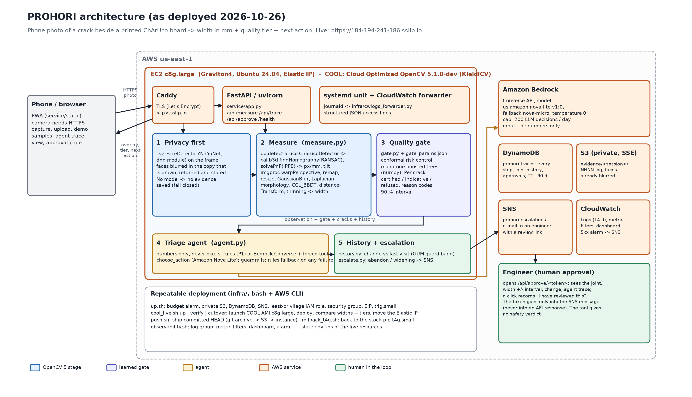
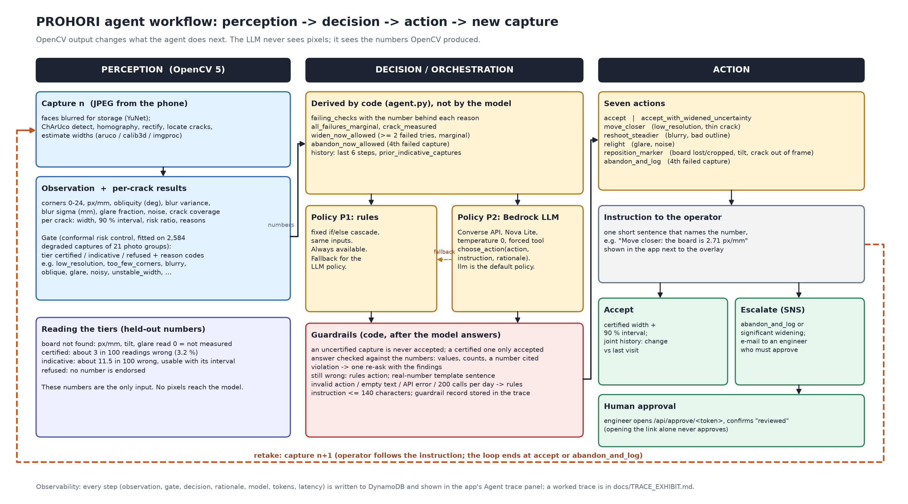
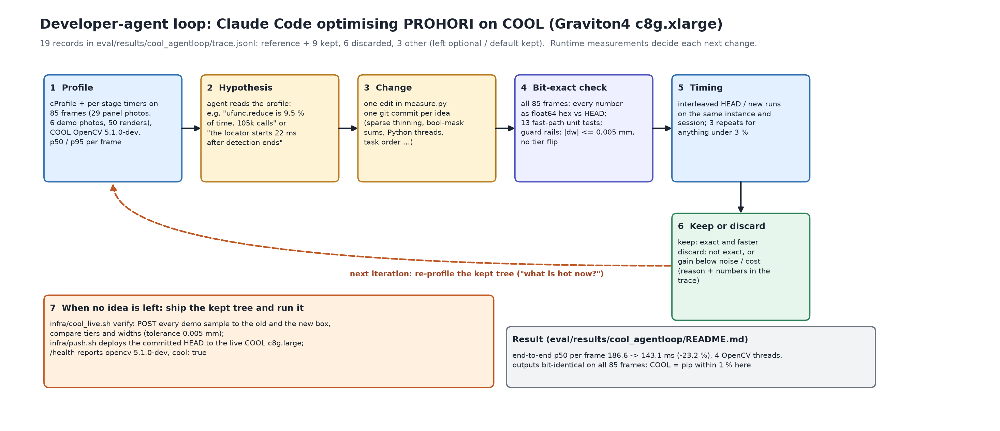

# PROHORI

**Crack width in millimetres from a phone photo, with a quality gate and an agent that tells you what to do when the photo is not good enough.**
Entry to the OpenCV AI Competition 2026 (Agentic Vision and Best Use of COOL awards), solo team.

* You photograph a concrete crack with a printed ChArUco board next to it. OpenCV 5 finds the board, rectifies the wall plane, and measures the crack width.
* A learned gate (conformal risk control) labels each crack **certified**, **indicative** or **refused**, with a 90 % interval and reason codes.
* An agent (fixed rules, or an LLM on Amazon Bedrock) reads those numbers, never the pixels, and says what to do next: move closer, hold steady, re-light, reposition the board, accept, or hand the case to an engineer who must approve it.
* It runs on one AWS Graviton4 instance (c8g.large) with COOL (Cloud Optimized OpenCV 5.1.0-dev).

**Live endpoint:** https://184-194-241-186.sslip.io
(HTTPS is required for the phone camera. Code: https://github.com/hozaifa1/prohori.)

## Try it in 30 seconds (judges)

1. Open https://184-194-241-186.sslip.io on a phone or a laptop.
2. Tap **Demo samples**. Pick "Much too far away": the gate refuses every crack and the agent says to move closer. Then pick "Closer shot": the same photo at a usable distance, and 5 of 8 cracks are certified.
3. Try "Board out of frame" (no board, no number, the agent asks to reposition) and "Blurry and skewed".
4. Open **Agent trace** at the bottom of the result to see the observation, the gate reasons and the decision for each step. In the policy selector, **llm** (the default) uses Amazon Bedrock (Nova Lite) behind a code-side guardrail that checks every answer; **rules** is the baseline. The result card shows which policy and model decided and what the guardrail did.
5. Own photo: print `data/print/PRINT_ME_test_panel_A4.pdf` at 100 % (it has the ChArUco board and eight printed test cracks of 0.3 to 3.0 mm), photograph it with a phone from 20 to 45 cm with the whole board in frame, and upload it.
6. API: `curl -F image=@photo.jpg https://184-194-241-186.sslip.io/api/measure`, then `GET /api/trace/<session_id>`, `GET /health`.

A worked trace is in [docs/TRACE_EXHIBIT.md](docs/TRACE_EXHIBIT.md); bad-capture cases are in [docs/FAILURE_GALLERY.md](docs/FAILURE_GALLERY.md).

## Hard requirements: where each one is

| Requirement | Where |
|---|---|
| Technical report | This README plus the method notes in [research/](research/) ([GATE_NOTES](research/GATE_NOTES.md), [WIDTH_AUTORESEARCH](research/WIDTH_AUTORESEARCH.md), [AGENT_PREREG](research/AGENT_PREREG.md), [COOL_NOTES](research/COOL_NOTES.md), [SERVICE_NOTES](research/SERVICE_NOTES.md), [METRICS](research/METRICS.md)) and the result files under [eval/results/](eval/results/) |
| Code repository | this repository (Apache-2.0) |
| Pinned dependencies, build, deploy, test | [Install](#install), [Tests](#run-the-tests), [Deploy](#deploy-to-aws) below; `service/requirements.txt`, `requirements-test.txt`, `requirements-eval.txt` |
| Architecture diagram | [docs/figures/architecture.png](docs/figures/architecture.png) ([svg](docs/figures/architecture.svg)) |
| Agent workflow diagram (perception, decision, action) | [docs/figures/agent_workflow.png](docs/figures/agent_workflow.png) ([svg](docs/figures/agent_workflow.svg)) |
| Trace where OpenCV output changes a later decision | [docs/TRACE_EXHIBIT.md](docs/TRACE_EXHIBIT.md) |
| Developer-agent workflow (COOL optimisation loop) | [docs/figures/dev_agent_loop.png](docs/figures/dev_agent_loop.png), [eval/results/cool_agentloop/](eval/results/cool_agentloop/README.md) |
| Working public endpoint | https://184-194-241-186.sslip.io |
| Video, 5 minutes or less | https://youtu.be/TFY_xzDJWNI (script: [docs/video/SCRIPT.md](docs/video/SCRIPT.md), captions: [docs/video/Prohori_demo.srt](docs/video/Prohori_demo.srt)) |
| Evaluation evidence, failure cases, limitations | [Results](#headline-results), [docs/FAILURE_GALLERY.md](docs/FAILURE_GALLERY.md), [Limitations](#limitations) |

## Architecture



Request path: phone, Caddy (TLS), FastAPI, then in order: face redaction (YuNet via `cv2.FaceDetectorYN`), measurement
(`aruco.CharucoDetector`, `findHomography`, `solvePnP`, `warpPerspective`, `remap`, connected components, distance transform, thinning, width estimators),
quality gate, triage agent, history and escalation. State goes to DynamoDB (traces, joint history, approvals) and S3 (evidence images, faces already blurred).
Escalations go to SNS and need a named engineer to confirm on the approval page. Logs, metric filters, a dashboard and a 5xx alarm are in CloudWatch.

### Agent workflow



The model's only input is a JSON of numbers (corners found, px/mm, tilt, blur, glare, per-crack widths, gate tier and reasons, the last six steps). It answers through one forced tool call,
`choose_action`. Guardrails in code run after it: an uncertified capture can never be accepted, a certified capture is only accepted (one optional retake if it is only indicative),
an invalid answer or an API error falls back to the rules policy, and a daily cap of 200 LLM decisions bounds the cost. The instruction text is checked against the measured numbers (every number must match, "all cracks certified" must be true, one measured number must be cited); a violation gets one re-ask, and a still-wrong action or sentence is replaced by the rules wording with the real numbers.

### Developer-agent loop (COOL)



## Headline results

Every number below is copied from a result file in this repository. The files contain the intervals, the protocol and more caveats; read them before quoting a number.

### Width accuracy (`eval/results/width_eval.md`, held-out TEST split, produced once after the configuration was frozen)

Real printed-panel photos, 8 TEST photos, 63 crack measurements. Truth = printed stroke width plus toner spread (U_ref = +-0.009 mm).

| Set | n | MAE (mm) [95 % CI] | MRE |
|---|---|---|---|
| Panel photos, all gate states | 63 | 0.070 [0.048, 0.098] | 7.4 % |
| Panel photos, certified cracks only | 41 | 0.056 [0.042, 0.074] | 3.9 % |
| Panel photos, cracks under 0.5 mm, all gate states | 16 | 0.055 [0.035, 0.077] | 14.7 % |
| Photoreal renders (exact truth), all gate states | 162 | 0.098 [0.080, 0.119] | 9.0 % |

The tier "Floor" of the pre-registered targets (MAE at most 0.09 mm) is met on the panel photos; the "Target" (MAE 0.05 mm, P95 0.10 mm) is not (P95 0.209 mm all states, 0.143 certified). The 2.0 and 3.0 mm
specimens are under-read by 0.16 and 0.14 mm. The gain of the shipped estimator over the 2026-10-19 one is small on real photos (MAE 0.075 to 0.070 mm, inside the intervals).

### Quality gate (`eval/results/gate_report.md`, `research/GATE_NOTES.md` sections 8 and 9)

Fitted on 2,584 degraded captures (18,683 crack measurements) derived from 21 source-photo groups. A reading is "wrong" if it is off by more than max(0.05 mm, 10 % of the width). Numbers are means over 100 random splits that hold out 6 source photos.

| Tier | Level | Held-out CRC risk | Cracks certified | Wrong, given certified |
|---|---|---|---|---|
| Certified (green) | alpha_cal 0.01 | 0.74 % | 25.8 % | 3.2 % (about 97 in 100 within tolerance) |
| Indicative (amber) | alpha_cal 0.05 | 4.30 % | 38.7 % | 11.5 % (about 88 in 100 within tolerance) |

The 90 % conformal width interval covers 91.5 % of held-out readings overall (median half-width of certified readings 0.179 mm); with whole photos left out one at a time, 53.6 % of the original photos' cracks are certified at the indicative level and 10.0 % of those are wrong. In 69 of 100 splits the risk stays under its target; the guarantee does not hold for new walls or new phones.

### Agent (`eval/results/agent_ablation.md`)

Simulated capture episodes (100 held-out), recovery to a certified capture within three actions:

| Subset | n | Random | Rules (P1) | LLM Nova Lite (P2) | LLM Nova Lite + guardrail (P2g) | Label-rule ceiling |
|---|---|---|---|---|---|---|
| single-cause failure | 20 | 30 % | 95 % | 100 % | 100 % | 100 % |
| compound failure | 48 | 2 % | 62 % [48, 75] | 85 % [75, 94] | 88 % [77, 96] | 88 % |
| all recoverable | 68 | 10 % | 72 % [62, 82] | 90 % [82, 96] | 91 % [84, 97] | 91 % |

P2 minus P1 on compound episodes: +22.9 points, 95 % CI [+8.3, +37.5]. P2g minus P1: +25.0 points [+12.5, +37.5]; P2g minus P2: +2.1 [-10.4, +14.6], so the guardrail did not change recovery detectably. The LLM prompt was tuned on a separate dev set and the label rule written as plain code does about as well (88 %), so this shows that an LLM following written rules matches those rules in code, not that it reasons better.

What the guardrail changed is the text and the rule-keeping (Addendum B of the pre-registration, 100 held-out episodes):

| | Rules (P1) | LLM (P2) | LLM + guardrail (P2g) |
|---|---|---|---|
| instructions that cite a measured number and contain no wrong number or claim | 91 % | 54 % | 99 % |
| decisions that break a hard rule of the agent's prompt | 24 % | 19 % | 0 % |

The guardrail sent 58 % of the model's first answers back for a re-ask and replaced the sentence in 36 % of decisions (cost: 1.6 model calls per decision, US$0.06 for the whole 100-episode run). Claude Haiku 4.5 (P3) was not evaluated: Bedrock rejects the model until the AWS account submits Anthropic's use-case form, so the live model is Nova Lite. With the prompt's rules enforced, P2g's actions match the label policy almost exactly, so these results show guardrail plus LLM wording, not better reasoning than a good rule set. The study ran on the simulator, before the two-tier gate was installed, and was not re-run.

### COOL on Graviton4 (`eval/results/cool/20261025T002750Z/REPORT.md`, `eval/results/cool_agentloop/README.md`)

* **Verified.** COOL (AMI `ami-033e481a24f94c8cb`, OpenCV 5.1.0-dev, KleidiCV 0.7.0) runs the full measurement workload on c8g.large, c8g.xlarge and c8g.2xlarge for all 85 test frames. The live endpoint runs it on a c8g.large (`/health` reports `"opencv":"5.1.0-dev","cool":true`).
* **Speed against the stock pip wheel (5.0.0.93), same instance, 1 thread:** 1.014x end to end [1.010, 1.017]. That is a tie: the OpenCV calls that dominate this workload (ArUco detection, INTER_AREA resize, warpPerspective) are not the ones KleidiCV speeds up. At list price COOL is 6.8 % dearer per 1,000 frames on c8g.xlarge because of the software fee.
* **Faithfulness.** Widths from COOL are not bitwise identical to the pip wheel (max difference 0.030 mm, 1 borderline certification flip in 220 cracks); two plain builds of the same 5.0.0 source differ by the same amount. The error against the printed truth is the same in every build.
* **Developer-agent loop.** An agent (Claude Code) profiled the pipeline on COOL, proposed changes, checked every change for bit-identical output on all 85 frames, and kept 9 of 18 candidate changes: end-to-end p50 per frame 186.6 to 143.1 ms (-23.2 %) at 4 OpenCV threads, and 13.0 % lower cost per 1,000 frames at saturation (USD 0.00393 to 0.00342). The gains also apply to the pip build.

## Repository map

| Path | What |
|---|---|
| `src/prohori/` | the library: `measure.py` (pipeline), `board.py`, `gate.py` + `gate_params.json` (certification), `agent.py` (policies, prompt, guardrails), `redact.py` (face blur), `store.py`, `history.py`, `escalate.py`, `episodes.py` (agent simulator), `synth.py` (render generator), `widthbench.py`, `segeval.py`, `datasets.py` |
| `service/` | FastAPI app (`app.py`), the phone web app (`static/`), demo samples, [service/README.md](service/README.md) |
| `tests/` | pytest suite (310 tests) |
| `eval/` | evaluation scripts; `eval/results/` the published tables, figures and raw COOL runs |
| `infra/` | AWS scripts: `up.sh`, `cool_live.sh`, `push.sh`, `rollback_t4g.sh`, `observability.sh`, bootstrap scripts; `state.env` (ids of the author's live resources) is generated by `up.sh` and `cool_live.sh` and is not in git |
| `research/` | method notes, pre-registrations, literature, datasets, the competition fact sheet |
| `docs/` | figures, trace exhibit, failure gallery, demo screenshots, video script. `ENTRY_PROHORI*.md` are the August plans; parts of them (for example LightGlue re-identification) were not built |
| `models/` | the YuNet face detector (ONNX, MIT licence) |
| `data/print/` | the printable board and the test panel, with the ground-truth file |
| `tools/` | figure, exhibit, bundle and PDF generators |
| `grant/` | the August compute-grant proposal. Historical: its diagram and some of its claims describe an earlier plan and are superseded by `docs/figures/` |

## Install

Python 3.12 is required (3.12.10 was used). Versions are pinned; OpenCV is the pip wheel `opencv-contrib-python-headless==5.0.0.93`.
COOL (5.1.0-dev) comes with its AWS Marketplace AMI and is used only on the live box; every result in `eval/results/` except the COOL runs was produced with the 5.0.0.93 wheel.

```bash
git clone https://github.com/hozaifa1/prohori.git && cd prohori
python -m venv .venv
. .venv/bin/activate            # Windows (Git Bash): . .venv/Scripts/activate
pip install -r requirements-test.txt       # service + test dependencies
pip install -r requirements-eval.txt       # only if you re-run eval/ scripts or tools/
```

On Windows, `moto` contains deeply nested files. Keep the virtual environment at a short path (for example `C:/pv/prohori`) or enable Windows long paths; otherwise `pip install` stops with an OSError about a missing file.

## Run the tests

```bash
python -m pytest -q
```

310 tests: `310 passed` on the author's machine in about two minutes (a fresh clone may skip the tests that need the third-party textures and crack masks of the render generator, see `research/DATASETS.md`). AWS is mocked with moto; no credentials or network are needed.

## Run the service locally

```bash
uvicorn service.app:app --host 0.0.0.0 --port 8000
# open http://localhost:8000
```

The default policy is `llm` (Nova Lite behind the guardrail; `infra/agent.env`), and `PROHORI_DEFAULT_POLICY=rules` changes it. Without AWS credentials, with the daily cap used up, or if the model keeps breaking a hard rule, `policy=llm` falls back to `rules` (the response says why in `fallback_reason`). To use Bedrock locally, export AWS credentials for a role that can call `bedrock:InvokeModel` on `us.amazon.nova-lite-v1:0` and set `PROHORI_BEDROCK_MODEL=us.amazon.nova-lite-v1:0`. Environment variables and API are in [service/README.md](service/README.md). Evidence is stored only after faces are blurred; if the face model is missing nothing is persisted.

## Deploy to AWS

Needs the AWS CLI logged in with rights to create IAM, EC2, S3, DynamoDB, SNS, CloudWatch and Budgets resources in us-east-1, and a bash shell. All scripts are idempotent.

```bash
export ALERT_EMAIL=you@example.com      # receives budget alarms and escalation e-mails (confirm the SNS subscriptions once)
bash infra/up.sh                        # budget alarm, private S3, DynamoDB, SNS, least-privilege role, security group, Elastic IP,
                                        # a t4g.small (Graviton2) with Caddy + Let's Encrypt on <ip>.sslip.io; writes infra/state.env
bash infra/observability.sh             # log group, metric filters, dashboard, 5xx alarm, log forwarder
bash infra/cool_live.sh up              # launch a c8g.large from the COOL AMI (needs a Marketplace subscription), bootstrap, deploy HEAD
bash infra/cool_live.sh verify          # POST every demo sample to the old and the new box, compare tiers and widths (tolerance 0.005 mm)
bash infra/cool_live.sh cutover         # move the Elastic IP to the COOL box; rolls back by itself if verification fails
bash infra/push.sh                      # ship the committed HEAD to the live box and restart (TARGET=<ip> for one specific box)
bash infra/rollback_t4g.sh              # one-command rollback to the stock-pip t4g.small
```

`infra/state.env` (ids of the resources: account, bucket, instances, Elastic IP) is generated by `up.sh` and updated by `cool_live.sh`; it is git-ignored, so a fresh clone has none and `up.sh` creates yours. `push.sh`, `observability.sh` and the other scripts read it. On a COOL box `push.sh` installs the requirements without the OpenCV line, so `import cv2` stays COOL's.

## Reproduce each result

Data bundles are attached to the GitHub release `v1.0-submission` (https://github.com/hozaifa1/prohori/releases/tag/v1.0-submission). Unpack them at the repository root.
The raw photos and logs are not in git (about 90 MB); the rest of what the tables need is.

| Bundle | Size | SHA-256 |
|---|---|---|
| `prohori-panel-data-v1.zip` (29 panel photos, gate-calibration manifests and rows, frozen splits, synthetic-render config and hashes) | 89,874,441 bytes | `39bb139dc2bffaceb094036688949b18c80bca7c04eec7c0bbe945f3fcd30a9f` |
| `prohori-agent-ablation-v1.zip` (episode logs including P2g, LLM ledger, prompts, pre-registration hashes) | 700,497 bytes | `c264e8a820d75d9cbb195a56ea9c74b9c1dae45206ef3af5e3d0b23fa3edca75` |

```bash
gh release download v1.0-submission -R hozaifa1/prohori -p "prohori-*.zip" -p SHA256SUMS.txt
sha256sum -c SHA256SUMS.txt && unzip -o prohori-panel-data-v1.zip && unzip -o prohori-agent-ablation-v1.zip
```

| Result | Command (from the repository root) | Needs |
|---|---|---|
| Gate report, tiers, intervals (`gate_report.md`) | `python eval/gate_fit.py --stage out/gate` | repository only (`eval/results/gate_calibration_features.parquet`); writes into `out/gate`, not over the deployed gate |
| Distance-feature experiment (`gate_distance.md`) | `python eval/gate_distance.py --out out/gate_distance.md` | repository only |
| Agent ablation report (`agent_ablation.md`, `.csv`, `.png`) | `python eval/agent_ablation.py report` | agent bundle. Overwrites the file in `eval/results/`; `git diff` shows any difference |
| Agent free policies, re-run (no model calls) | `python eval/agent_ablation.py run --split test --policies p0,p1,pstar` | agent bundle |
| Agent LLM policy, re-run | `python eval/agent_ablation.py run --split test --policies p2 --tag test_final` | Bedrock access to Nova Lite, about USD 0.04 |
| Agent with guardrail, re-run | `python eval/agent_ablation.py run --split test --policies p2g` | Bedrock access to Nova Lite, about USD 0.06 |
| Panel-photo table (`panel_photos_*.md`) | `python eval/run_panel_photos.py --tag repro` | panel bundle |
| Gate calibration set from the photos | `python eval/gate_make_dataset.py --cfg shipped --variants 120 --workers 4` (hours); `--table-only` rebuilds the table from the stored manifest | panel bundle |
| Width evaluation (`width_eval.md`) | `python eval/width_eval.py build`, then `python eval/width_final.py --split test --go` (refuses to run twice on one machine; the bundle does not contain the lock file) | panel bundle, the 500 renders, krkCMd data (see below) |
| Synthetic renders | `python -m prohori.synth --n 500 --out data/synth/v1 --seed 0` | ambientCG textures and the crack datasets in `data/datasets/` (see [research/DATASETS.md](research/DATASETS.md)); compare with `data/synth/v1/synth_render_sha256.txt` from the bundle (expected to match only on the same OpenCV / numpy / libjpeg build) |
| COOL benchmark tables (`cool/20261025T002750Z/REPORT.md`) | `python eval/cool_bench.py compare <pip.bench.json> <cool.bench.json>`; commands per figure in [research/COOL_NOTES.md](research/COOL_NOTES.md) | repository only (raw JSON is committed); a fresh COOL run needs a c8g instance (`infra/cool_session.sh`) |
| COOL developer-loop tables and figure | `python eval/cool_loop_report.py` | repository only |
| Figures, exhibits | `python tools/make_figures.py`; `python tools/make_exhibits.py trace|gallery` | the second needs a running endpoint (`--base`) |

The width evaluation cannot be reproduced from the bundle alone: its synthetic half needs the 500 renders (1.1 GB, built from third-party textures and crack masks) and its black-core rows need the krkCMd profile data. The panel half and the gate, agent and COOL results can.

## Responsible use

* **Faces.** Every uploaded frame is scanned with the YuNet face detector; faces are blurred in the copy that is drawn on, returned and stored. If the detector is unavailable the service stores nothing. Measurement uses the original pixels in memory only. Evidence images in S3 are private and encrypted; DynamoDB rows expire after 90 days.
* **Human approval.** The agent can ask for an escalation (after the fourth failed capture, or when a joint widens beyond its measurement uncertainty), but it only sends a message. A named engineer opens a link, reads the case, and confirms. Opening the link does not approve it, and the link's token never appears in an API response, so the person taking the photo cannot approve their own escalation.
* **No safety verdict.** PROHORI measures a crack width and says how far to trust it. It does not decide whether a building is safe, and every escalation message says so. A qualified engineer must make that call.
* **Cost and abuse limits.** Uploads are capped at 15 MB, 30 requests per minute per IP, and 200 LLM decisions per day.

## Limitations

Short list; the details sit next to the numbers in the linked files.

* **One sheet, one phone, one session.** All real photos are of one printed test panel taken with one phone on one day. No real concrete crack has been measured against a microscope. The panel reference has a stated uncertainty of +-0.009 mm; a real crack's edge is much less well defined. (`width_eval.md`)
* **Accuracy targets not met.** MAE 0.070 mm over all gate states (target 0.05 mm). Cracks under 0.5 mm did not improve over the previous estimator. The 2 and 3 mm specimens are under-read by 0.14 to 0.16 mm. (`width_eval.md`)
* **Small calibration set.** The gate learned from degraded copies of 21 photo groups. Its risk guarantee is only checked empirically on held-out photos (risk under target in 69 of 100 splits); it is not claimed for new surfaces, lighting or phones. Interval coverage at 0.3 mm is 86.3 % (the other width bins are at least 89.5 %) when whole photos are held out. (`gate_report.md`, `GATE_NOTES.md`)
* **The gate is per crack, and does not react to everything.** A capture counts as certified when one crack is certified, so a blurred photo can be "certified" through its widest crack (with a wide interval). The learned gate has no separate glare threshold; moderate glare is not refused. (`docs/FAILURE_GALLERY.md`)
* **The agent study is a simulation.** The LLM's gain over the rules is measured on a simulator with assumed failure distributions, one cheap model and a cooperative operator; the lower end of the interval is under the pre-registered +10 points; the prompt was tuned on dev episodes; the study predates the two-tier gate and measures the older prompt, not the prompt the live service uses. Without the guardrail the LLM's text sometimes cited a wrong number or said "all cracks certified" when some were not (54 % faithful against 91 % for the rules); the guardrail raises that to 99 % in the simulation, partly because it swaps in the rules wording for 36 % of decisions, and its checks are code, so they can be too strict or miss a claim. Claude Haiku 4.5 was not evaluated (the AWS account has not submitted Anthropic's use-case form). The human rating of instruction text was not done. (`agent_ablation.md`, `docs/TRACE_EXHIBIT.md`)
* **COOL is a tie for this workload.** It runs the workload correctly on Graviton4 but is not faster than the pip wheel (1.014x), costs 6.8 % more per frame at list price, is not bitwise identical to the pip build, ships no opencv_contrib, and its default multithreaded connected-components call crashes the process (the code uses `CCL_BBDT` instead). The 23 % speed-up of the developer loop comes from changes to this repository's Python code and also applies to the pip build. (`cool/.../REPORT.md`, `cool_agentloop/README.md`)
* **Requirements on the user.** A printed board at 100 % scale lying flat in the crack's plane, a phone camera with focus, and a distance of roughly 20 to 45 cm. Thin cracks (0.3 to 0.5 mm) need about 10 to 20 px/mm to certify.
* **No crack tracking across visits.** The operator names the joint; the system does not re-identify cracks (the earlier LightGlue plan was dropped).

## License

Code: Apache License 2.0 ([LICENSE](LICENSE), [NOTICE](NOTICE)). The panel photos and the data bundles: Creative Commons Attribution 4.0 International (CC BY 4.0), attribution "PROHORI panel photos, Hozaifa, 2026". Third-party datasets, textures and models are **not** redistributed here or in the bundles and keep their own licences.
The YuNet model file in `models/` is the unmodified OpenCV Model Zoo file (MIT).

## Acknowledgements and citations

Software: OpenCV 5 (aruco/objdetect, calib3d, imgproc, dnn, `FaceDetectorYN`), COOL by OpenCV.ai on AWS Marketplace (KleidiCV by Arm), FastAPI, NumPy, boto3, scikit-learn, pandas, matplotlib, Caddy.

Methods and papers used (full notes in [research/LITERATURE.md](research/LITERATURE.md) and [research/METRICS.md](research/METRICS.md)):

* Angelopoulos, A. N., Bates, S., Fisch, A., Lei, L., Schuster, T. Conformal Risk Control. ICLR 2024 (the gate's loss and threshold rule).
* Hassouna, M., Marzouk, M., Fathalla, E. Automated low-cost framework for crack measurements in RC structures using deep learning approach. Scientific Reports 2026, doi:10.1038/s41598-026-50880-w (published ratio, COV and error bins used as targets).
* Deng, P. et al. 3D modeling and automated measurement of concrete cracks via Segment Anything refinement and visual inertial LiDAR fusion. Computer-Aided Civil and Infrastructure Engineering 2026, doi:10.1016/j.cacaie.2026.100019 (mask quality checks, MAE and MRE anchor).
* Jakubowski, J., Tomczak, K. Dataset for developing deep learning models to assess crack width and self-healing progress in concrete (krkCMd). Scientific Data 2025, doi:10.1038/s41597-025-04485-z; data doi:10.5281/zenodo.11408398 (width estimator benchmark).
* Garrido-Jurado, S., Munoz-Salinas, R., Madrid-Cuevas, F. J., Marin-Jimenez, M. J. Automatic generation and detection of highly reliable fiducial markers under occlusion. Pattern Recognition 47(6), 2014 (ArUco / ChArUco).
* Zhang, T. Y., Suen, C. Y. A fast parallel algorithm for thinning digital patterns. Communications of the ACM 27(3), 1984.
* Wu, W., Peng, H., Yu, S. YuNet: A tiny millisecond-level face detector. Machine Intelligence Research 20(5), 2023, doi:10.1007/s11633-023-1423-y.
* JCGM 100:2008 (GUM) and JCGM 106:2012 (uncertainty in conformity decisions), for the change-detection guard band in `history.py`; Theil (1950) and Sen (1968) for the robust trend.

Data used for the synthetic renders and the segmentation baseline (not redistributed; licences and checksums in [research/DATASETS.md](research/DATASETS.md)): ambientCG concrete and plaster textures (CC0); crack masks from Crack500 and the pavement benchmark archive of Yang et al. (IEEE TITS 2019), CFD, CrackTree200, AEL, GAPs384, DeepCrack (Liu et al., Neurocomputing 2019, non-commercial research use), CrackSeg9k (Kulkarni et al., CVPRW 2022, CC0), TUT, Facade390 and Road420 (CrackSAM, Ge et al., Construction and Building Materials 431, 2024, CC BY 4.0). The OmniCrack30k benchmark (Benz and Rodehorst, CVPRW 2024) was not available and was not used.
