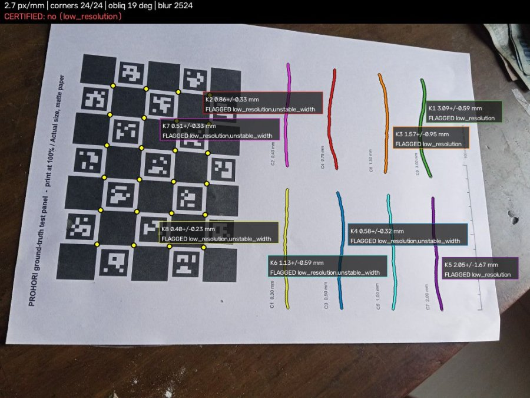
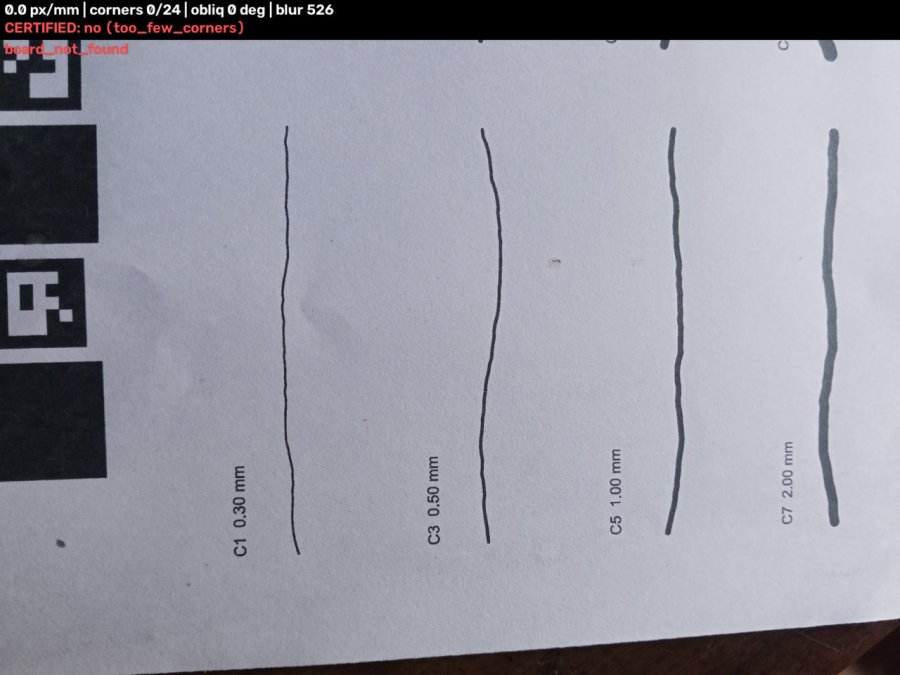
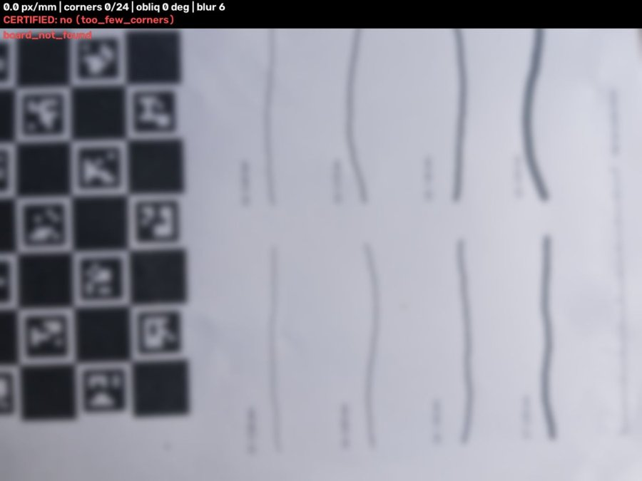
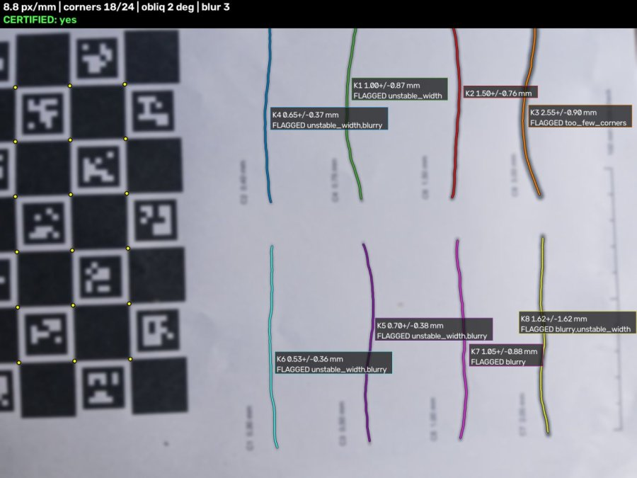
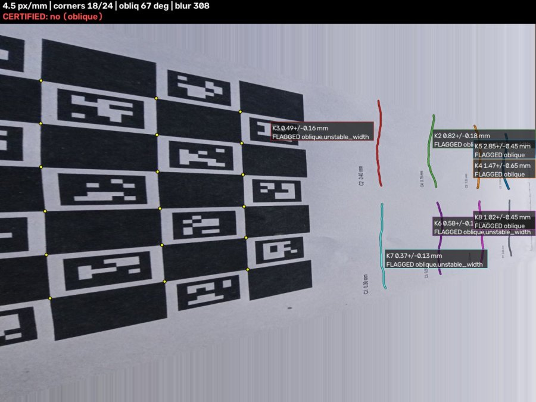
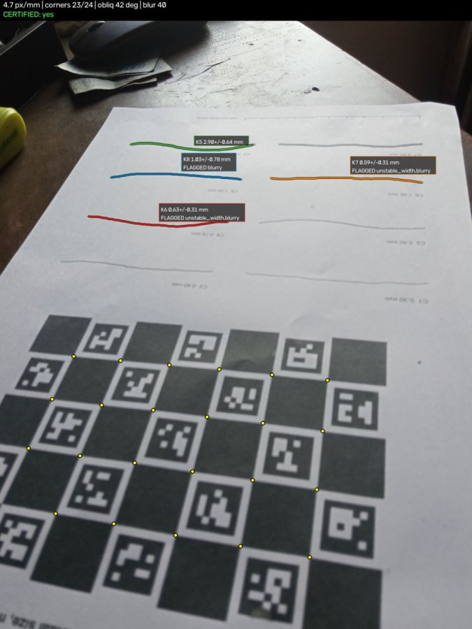
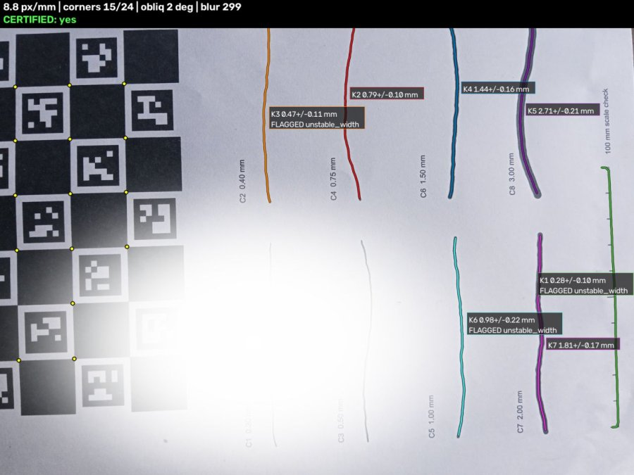

# Failure gallery

What the quality gate and the agent do when the capture is bad, run against the live endpoint on 2026-10-26 (COOL, Graviton4 c8g.large).
Each case was sent twice, once with the Bedrock LLM policy (Nova Lite) and once with the rules policy. Inputs, overlays and raw numbers are in
[`exhibits/gallery/`](exhibits/gallery/) (`<case>.json`, `<case>.jpg` overlay, `<case>_input.jpg`); regenerate with
`python tools/make_exhibits.py gallery`. The LLM answers can differ between runs (temperature 0 reduces but does not remove this).

Inputs are either **real** photos of the printed test panel or **synthetic degradations** of the real photo `good-straight.jpg`
(Gaussian blur, a white blob, a perspective squeeze), so that the cause is known. The recipes are in `tools/make_exhibits.py`.
The gate was calibrated on 29 photos of one printed sheet taken with one phone; none of these cases is a field test.

## Summary

| Case | Input | OpenCV observation | Gate | Agent (LLM / rules) |
|---|---|---|---|---|
| [Too far](#too-far) | real photo, shrunk x0.25 | 2.71 px/mm, 24/24 corners | **refused**, 0/8 cracks, `low_resolution` | `move_closer` / `move_closer` |
| [Board mostly out of frame](#board-partly-visible) | real photo | 0 corners found, nothing else measurable | no result, `too_few_corners` | `reposition_marker` / `reposition_marker` |
| [Heavy blur](#blur) | synthetic, sigma 11 px | 0 corners (board lost), blur variance 5.6 | no result, `too_few_corners` | `reposition_marker` / `reshoot_steadier` |
| [Mild blur](#blur) | synthetic, sigma 5 px | 18 corners, blur sigma 0.464 mm, 8.8 px/mm | **certified** (capture), only 1/8 cracks | `accept` / `accept` |
| [Steep angle, extreme](#oblique) | synthetic squeeze | 66.6 deg, 4.5 px/mm | **refused**, 0/7, `oblique` | `reposition_marker` / `reposition_marker` |
| [Steep and shaky, real](#oblique) | real photo (`blurry-oblique`) | 42.4 deg, blur variance 40, blur sigma 0.30 mm | **indicative**, 1/4 cracks | `accept` / `reshoot_steadier` |
| [Glare](#glare), 4 % | synthetic blob | glare 4.3 %, 18 corners | **certified**, 5/8 | `accept` / `accept` |
| [Glare](#glare), 12 % | synthetic blob | glare 11.7 %, 15 corners | **certified**, 4/7 | `accept` / `accept` |
| Control | real good photo | 8.8 px/mm, 18 corners, 1.8 deg | **certified**, 4/8 | `accept` / `accept` |

Read the table in two halves. The first half (too far, board lost, extreme angle) is what the system is built for: OpenCV's number
becomes a reason code and the reason becomes an instruction. The second half is where the system does **not** refuse, and the
limitations section of the README lists them as limitations.

## Too far

OpenCV measured 2.71 px/mm. The gate refused all 8 cracks with `low_resolution`. LLM: "Move closer: the board is 2.71 px/mm, a 0.5 mm crack
needs about 20." Rules: "Move closer: only 2.4 px/mm here, aim for 8 or more." The action is right in both. The LLM's number is wrong (the
guidance in its prompt is about 10 px/mm for a 0.4 to 0.5 mm crack and about 20 for 0.3 mm). After the closer photo, the same board certified 5 of 8
cracks ([TRACE_EXHIBIT.md](TRACE_EXHIBIT.md)).

## Board partly visible

The photo shows part of the board; ChArUco detection returned 0 usable corners (the pipeline needs at least 6). Without the board there is no
scale, so no width is reported (0 cracks, no tier). px/mm, tilt and glare read 0, which the agent's prompt defines as "not measured". Both policies ask to
reposition the marker. The rules say "put the whole board beside the crack and retake (0 of 24 corners)".

## Blur

With sigma 11 px of added blur the board is lost (0 corners) and only the whole-frame sharpness is left (variance 5.6; below about 150 counts as soft in the agent's guidance, the control photo has 487). The agent's rule
for a lost board (prompt rule 2a) is: blur variance below 100 means `reshoot_steadier`. The **rules** policy does that. The **LLM chose `reposition_marker` instead** in this run,
which does not follow its own prompt; the action is still harmless (the operator retakes the photo) but it is a wrong diagnosis. This is the kind of deviation the
ablation found (action matches the label set 73 % of the time on compound failures for Nova Lite; rules 69 %).

With sigma 5 px the board is still found (blur variance 2.6, blur sigma 0.464 mm on the wall). **The capture is certified** because one crack (the 1.5 mm one) passes the gate, with a 90 % interval of
0.73 to 2.26 mm. The other 7 are flagged. This is the per-crack design working as specified (a wide crack tolerates blur, since the allowed error is 10 % of the width),
but a capture-level "certified" next to a wide interval is easy to misread; the app prints every crack's own status and interval.

## Oblique

A perspective squeeze to 66.6 degrees: the gate refuses everything with `oblique`. Both policies say to stand square to the wall.

The real steep and shaky photo (42 degrees, blur variance 40) is **indicative** (1 of 4 cracks pass the looser level; about 11.5 in 100 indicative readings are wrong on held-out data).
The rules policy uses the optional improving action for a first indicative capture: "Usable as is. For a certified reading: Hold steady and retake". The LLM accepted.
Both are allowed by the guardrail for an indicative capture.

## Glare

Glare up to 11.7 % saturated pixels, 15 of 24 corners still found: the gate still certifies 4 of 7 cracks. The deployed gate has no per-feature glare threshold (it is a learned model,
`eval/results/gate_report.md` section 7: glare alone "always passes"). `relight` is therefore only chosen when glare is a reason code, which in this build usually means the board
is hidden. The LLM's sentence "all cracks are certified" is wrong here (4 of 7); the rules sentence says "4 of 7". The synthetic blob is a white disc, not a real specular
reflection, so this case shows that the gate is not sensitive to glare in the 4-12 % range on this image, not how real glare behaves.

## What this gallery does not show

* Real field cracks, rough or dark surfaces, shadows across the board, a wrinkled sheet, a different phone. None was tested.
* More than one run per case. The gate and the rules are deterministic; the LLM text is not.
* `abandon_and_log` and the SNS escalation: they trigger on the 4th failed capture in a session or on a significant widening across visits; see `tests/test_escalate.py`
  and the simulated episodes in `eval/results/agent_ablation.md`.
