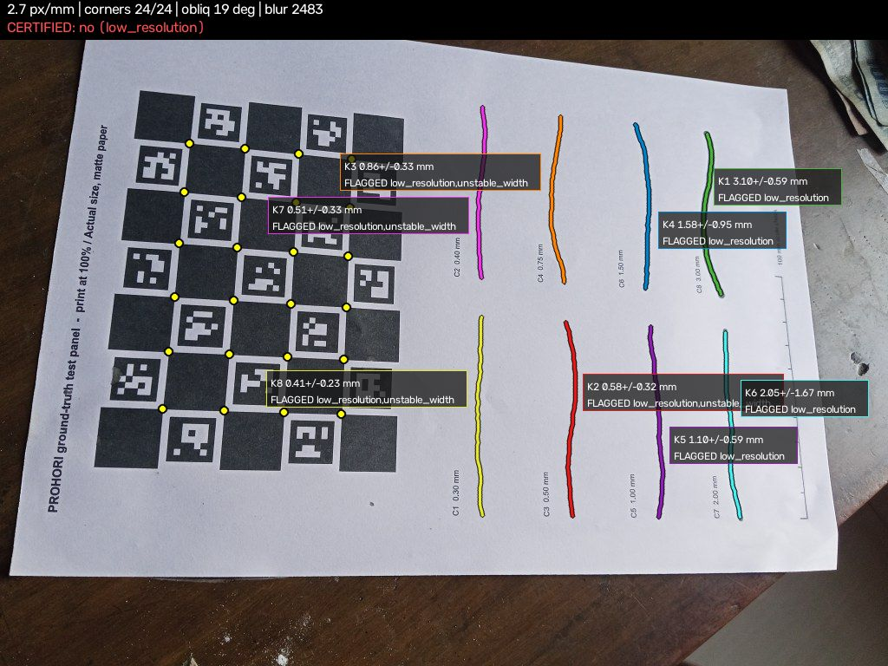
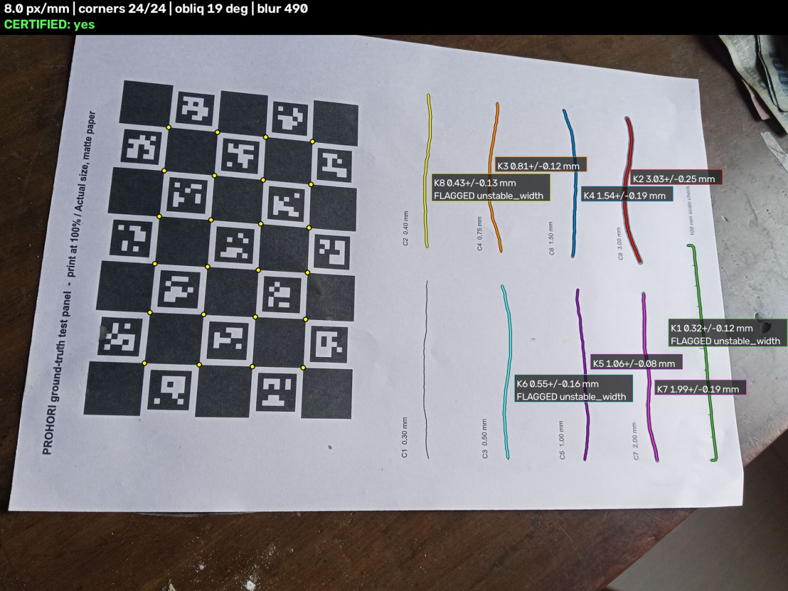

# Agent trace exhibit: OpenCV output changes the next action

This is one real trace from the live endpoint (https://184-194-241-186.sslip.io, COOL on a Graviton4 c8g.large, policy `llm`,
model `us.amazon.nova-lite-v1:0`), recorded 2026-10-26 15:08 UTC, after the guardrail was deployed (build `b3e9907`). Session id `exhibit-20261026T150829`. The default policy of the endpoint is now `llm`; this exhibit asks for it explicitly. The full stored trace, as
`GET /api/trace/<session_id>` returned it, is in [`exhibits/trace_exhibit.json`](exhibits/trace_exhibit.json). The two overlays are
`exhibits/trace_step0_overlay.jpg` and `exhibits/trace_step1_overlay.jpg`. To make a new one: `python tools/make_exhibits.py trace`.

The two photos are the demo samples `move-closer.jpg` (a real photo of the printed test panel, shrunk to a quarter of its size to mimic
standing too far back) and `closer.jpg` (the same photo shrunk less, 3072 px wide, which is the distance the agent asked for). The app
offers them as a two-step story. So the "operator" in this exhibit is a script that follows the instruction; a real person would take a new photo.

## Step table

| | Step 0 (first capture) | Step 1 (after the instruction) |
|---|---|---|
| Image | 1024 x 768 | 3072 x 2304 |
| **OpenCV 5 observation** | | |
| ChArUco corners found | 24 of 24 | 24 of 24 |
| px/mm at the cracks (board) | **2.71** (3.14) | **7.98** (9.41) |
| Obliquity | 19.4 deg | 19.4 deg |
| Blur variance / blur sigma | 2483 / 0.135 mm | 490 / 0.105 mm |
| Glare / noise | 0 % / 1.5 grey levels | 0 % / 0.8 grey levels |
| **Gate (conformal risk control)** | | |
| Tier | **refused** | **certified** |
| Cracks certified | 0 of 8 | 5 of 8 |
| Reason codes of the capture | `low_resolution` (every crack; K2, K3, K7, K8 also `unstable_width`) | none (K1, K6, K8 flagged `unstable_width`) |
| **Decision** (Nova Lite, forced tool `choose_action`, behind the guardrail) | | |
| Action | **`move_closer`** | **`accept`** |
| Instruction shown to the operator | "Move closer: the board is 2.71 px/mm, a 0.5 mm crack needs about 10." | "Accept the capture: 5 out of 8 cracks are certified." |
| Model calls | 1 call, 1,526 ms, 3,807 input / 95 output tokens | 2 calls (one re-ask), 1,543 ms, 7,840 input / 91 output tokens |
| Server time (decode, redact, measure, gate, agent, store) | 1.8 s | 2.0 s |
| Guardrail | clean, no re-ask | **first answer rejected, re-ask fixed it** (see below) |
| Fallback to rules | none | none |
| Escalation | none | none |

**Why this shows OpenCV output changing the next action.** In step 0 the only thing wrong is a number OpenCV computed: 2.71 px/mm on the
wall. The gate turns it into the reason code `low_resolution`, and every crack is refused. The agent's input is that observation, the gate
reasons and the crack list (no pixels). It picks `move_closer`, the action the prompt assigns to `low_resolution` when the board is otherwise
found (24 of 24 corners, sharp, 19 degrees). In step 1 the same photo content at 7.98 px/mm gives 5 certified cracks, an empty reason list, and the
agent's `accept` is the only action its guardrail allows on a certified gate. If the step-0 observation had shown a lost board, a steep angle or a soft picture instead, the same code path
would have produced `reposition_marker`, `reshoot_steadier` or `relight` (see [FAILURE_GALLERY.md](FAILURE_GALLERY.md)).

**What the guardrail did in this trace.** An earlier recording of the same two photos (2026-10-26 03:08 UTC, before the guardrail) showed two wrong sentences from the same
model: step 0 said "a 1.58 mm crack needs about 2.5 px/mm", which is below the 2.71 px/mm just measured, and step 1 said "all cracks are certified" when 3 of 8 were flagged.
In this recording step 0 passed the check (2.71 matches the measurement; "0.5 mm crack needs about 10" matches the 0.54 mm crack and the 10 px/mm guidance for it).
In step 1 the first answer was rejected by code with two findings, recorded in `decision.guardrail.violations`: "says 'all cracks are certified' but 5 of 8 cracks are certified" and
"cites no measured number". The model was asked once more with those findings and wrote "Accept the capture: 5 out of 8 cracks are certified." The action (`accept`) was
never in doubt: it is the only action allowed on a certified gate. If the second answer had still been wrong, the instruction would have been replaced by the rules policy's wording
for that action with the real numbers filled in. The guardrail is a check by code, not a second model, and it does not judge whether the advice is good.
In the held-out simulation (`eval/results/agent_ablation.md`, Addendum B) the same guardrail raised the share of instructions that cite a measured number without any wrong number or claim from 54 % to 99 %, with 36 % of the model's sentences replaced by the template.
The gate in step 1 is per crack: 3 of 8 cracks are still flagged, and the capture counts as certified because at least one crack is certified; the app lists every crack with its own status and interval.

## JSON excerpt (step 0, trimmed; the full record is in `exhibits/trace_exhibit.json`)

```json
{
  "session_id": "exhibit-20261026T150829", "step": 0,
  "observation": {"corners": 24, "px_per_mm": 2.71, "ppm_board": 3.14, "obliquity_deg": 19.39,
                  "blur_var": 2482.7, "blur_sigma_mm": 0.135, "glare_frac": 0, "noise_sigma": 1.499,
                  "crack_coverage": 1, "image_w": 1024, "image_h": 768},
  "gate": {"mode": "crc", "certified": false, "tier": "refused", "reasons": ["low_resolution"],
           "cracks_certified": 0, "cracks_total": 8},
  "decision": {"action": "move_closer", "policy": "llm", "model": "us.amazon.nova-lite-v1:0",
               "instruction": "Move closer: the board is 2.71 px/mm, a 0.5 mm crack needs about 10.",
               "rationale": "The px_per_mm is 2.71, which is too low for the crack widths measured. A 0.5 mm crack needs about 10 px/mm.",
               "guardrail": {"violations": [], "reask": false, "final_violations": [], "repaired": false, "action_rejected": false, "rationale_withheld": false},
               "llm_calls": 1, "latency_ms": 1525.61, "fallback_reason": null, "input_tokens": 3807, "output_tokens": 95},
  "escalation": null,
  "redaction": {"faces": 0, "model": "yunet_2023mar", "status": "ok", "persisted": true}
}
```

## JSON excerpt (step 1)

```json
{
  "session_id": "exhibit-20261026T150829", "step": 1,
  "observation": {"corners": 24, "px_per_mm": 7.98, "ppm_board": 9.41, "obliquity_deg": 19.39,
                  "blur_var": 490, "blur_sigma_mm": 0.105, "glare_frac": 0, "noise_sigma": 0.822,
                  "crack_coverage": 1, "image_w": 3072, "image_h": 2304},
  "gate": {"mode": "crc", "certified": true, "tier": "certified", "reasons": [],
           "cracks_certified": 5, "cracks_total": 8},
  "decision": {"action": "accept", "policy": "llm", "model": "us.amazon.nova-lite-v1:0",
               "instruction": "Accept the capture: 5 out of 8 cracks are certified.",
               "guardrail": {"violations": ["says 'all cracks are certified' but 5 of 8 cracks are certified",
                                            "cites no measured number: rule 1 says to name the measured number that triggered the action"],
                             "reask": true, "final_violations": [], "repaired": false, "action_rejected": false, "rationale_withheld": false},
               "llm_calls": 2, "latency_ms": 1542.88, "fallback_reason": null, "input_tokens": 7840, "output_tokens": 91}
}
```

(The `guardrail` record is part of the stored trace, so an auditor can see what the model first said and why it was sent back.)




Step 0 overlay: every crack flagged `low_resolution`. Step 1 overlay: the same board and cracks with 5 certified.
