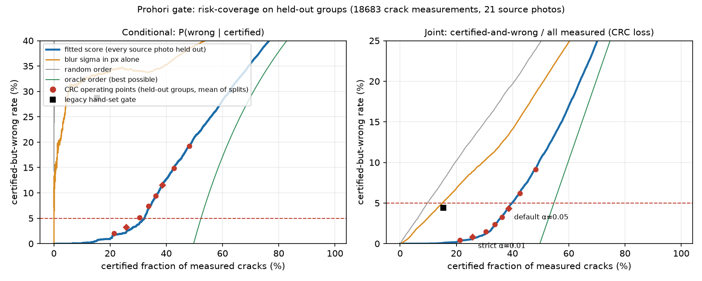
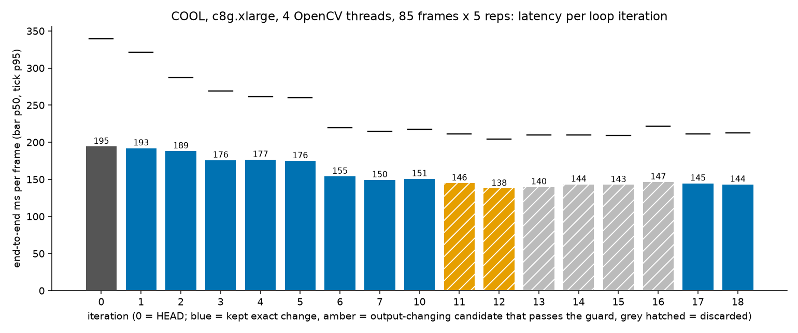

# PROHORI: crack width in millimetres from a phone photo, with a calibrated "refuse when unsure" gate and a recapture agent

Technical report, OpenCV AI Competition 2026 (Overall, Best Use of COOL, Agentic Vision). Solo entry: Hozaifa, University of Dhaka.
Live endpoint: https://184-194-241-186.sslip.io. Code: https://github.com/hozaifa1/prohori (Apache-2.0). Every number below is copied from a file in the repository; the file is named next to it.

Terms used throughout. "Certified (green)" is the strict tier. "Indicative (amber)" is the looser tier. A crack "passes the gate" if it is green or amber. "Refused" means no number is endorsed.

## 1 Abstract

PROHORI measures the width of a concrete crack from one phone photo that also shows a printed ChArUco board. OpenCV 5 finds the board, flattens the wall plane to a known scale and reads the width from grey levels. A gate calibrated with conformal risk control labels each crack **certified (green)**, **indicative (amber)** or **refused**, and an agent turns the gate's reasons into the next action: move closer, hold steady, re-light, reposition the board, accept, accept with a wider interval, or hand the case to an engineer who must approve it. It runs on one AWS Graviton4 instance (c8g.large) with the COOL AMI (OpenCV 5.1.0-dev, KleidiCV 0.7.0 HAL).
Headline results, all on data held out from tuning:
(1) width error on 8 held-out photos of a printed test panel: MAE 0.070 mm over 63 cracks, 0.056 mm over the 41 that pass the gate (`eval/results/width_eval.md`);
(2) on held-out photos, 3.2 % of certified (green) readings and 11.5 % of readings passing at the amber level are wrong, with 25.8 % and 38.7 % of cracks passing; the 90 % interval covers 91.5 % of readings (`eval/results/gate_report.md`);
<!-- AGENT_RESULTS_PENDING -->
(3) in a pre-registered simulator, an LLM agent recovers 85 % of compound-failure captures within three actions against 62 % for fixed rules; a re-run with a guardrail is pending (section 6; `eval/results/agent_ablation.md`);
(4) the COOL AMI runs the full workload on Graviton4 and ties the stock pip wheel (0.994x end to end at 4 threads after optimisation), and a developer agent cut per-frame latency by 23.2 % and cost per 1,000 frames by 13.0 % with bit-identical output (`eval/results/cool_agentloop/README.md`).
There is no field validation: all real photos are of one printed panel taken with one phone.

## 2 Problem and impact

**Context.** On 24 April 2013 the Rana Plaza building near Dhaka collapsed and 1,134 people died; cracks in its walls had been reported the day before. Bangladesh's garment factories have since been inspected under the Accord and the RMG Sustainability Council. Their reporting (as recorded in `docs/ENTRY_PROHORI.md`; not re-verified here) lists 93,576 hazards found in initial inspections of 1,755 factories and 665 of roughly 1,800 factories fully remediated, with inspector availability named as the bottleneck.

**What is measured in practice.** Crack width is usually judged by eye or with a plastic crack-comparator card. ACI 224R-01 Table 4.1 gives tolerable widths for reinforced concrete under service load as a durability guide: 0.41 mm (dry air), 0.30 mm (humid air, soil), 0.18 mm (de-icing chemicals), 0.15 mm (seawater), 0.10 mm (water-retaining) (`research/ADDENDUM.md`, corrected against the table). Dhaka is humid, so the decisions that matter sit at 0.3 to 0.5 mm, where a phone photo gives about 3 to 15 pixels per millimetre. A LiDAR rig measured against a microscope reports 15 to 34 % relative error below 0.5 mm (Deng et al. 2026, `research/LITERATURE.md` S8).

**Users.** Site engineers and inspectors in garment and residential buildings who need a repeatable number, an honest error bar, and a record of how it changed since the last visit. The first use is a walk-through with a phone and a printed A4 sheet.

**Why "refuse when unsure" is the core idea.** A thin crack photographed from too far, with blur or at a steep angle, still produces a confident-looking number. A wrong millimetre figure is worse than none, because it may be filed as a record. PROHORI therefore reports a number only when a gate, calibrated on held-out data, says how often such a number is wrong. When the gate refuses, the agent says what to change. PROHORI does not decide whether a building is safe; ACI itself warns that these widths are not a reliable indication of corrosion. Every escalation says so and needs a named engineer's confirmation.

## 3 System overview


Request path: phone (PWA over HTTPS, required for the camera), Caddy with Let's Encrypt on `<ip>.sslip.io`, FastAPI. Then, in order: face redaction, measurement, quality gate, triage agent, history and escalation. State goes to DynamoDB (traces, joint history, approvals) and S3 (evidence images, faces already blurred). Escalations go to SNS. Logs and a 5xx alarm go to CloudWatch. The Python package `src/prohori/` is 7,383 lines and calls OpenCV directly; there is no deep segmentation network in the product path.

**OpenCV 5 in the product path** (verified by reading the call sites; `cv2.ximgproc` is not used, so the contrib package is not needed on COOL):

| Module | Calls | Used for | Where |
|---|---|---|---|
| objdetect | `aruco.CharucoDetector.detectBoard`, `FaceDetectorYN.create` | find the 7x5 ChArUco board (24 inner corners); detect faces before storage | `measure.py:123,228`, `redact.py:96` |
| calib3d | `findHomography` (RANSAC), `solvePnP` (IPPE), `Rodrigues`, `cornerSubPix` | image to board millimetres, tilt, sub-pixel corners | `measure.py:243-264` |
| imgproc | `warpPerspective`, `remap`, `resize` (INTER_AREA), `GaussianBlur`, `Laplacian`, `Sobel`, `filter2D`, `medianBlur`, `erode`/`dilate`/`morphologyEx`, `connectedComponentsWithStatsWithAlgorithm` (BBDT), `distanceTransform`, `findContours` | rectification, crack locator, sharpness and glare measures, mask quality checks, width profiles | `measure.py` |
| imgcodecs, core | `imdecode`, `imencode`, array arithmetic | JPEG in, annotated overlay out | `service/app.py:225` |
| dnn | YuNet ONNX model run by `FaceDetectorYN` | face redaction | `models/` (OpenCV Zoo, MIT) |

## 4 Measurement method

**Pipeline** (`src/prohori/measure.py`).
1. Detect the board on a grey copy of at most 2,000 px, refine corners at full resolution, fit a homography from image to board millimetres, and a pose for the tilt angle. At least 6 corners are required; without them no number is produced.
2. Rectify the page at low resolution and locate dark, thin, elongated components. Then rectify a tight region around each crack at full resolution, at no less than native pixels per millimetre.
3. Skeletonise the crack and sample the grey-level profile across it at every station along the skeleton. Estimate the width from the profile: a half-maximum width with a closed-form correction for Gaussian blur, blended continuously with an area-conserving estimate for cracks that are not resolved. The smoothing scale follows the blur measured from the board edges. The width is the median over stations.

Widths come from grey levels, not mask edges, because even the best crack segmenter agrees with human labels on the exact centreline pixel only 16.2 % of the time (OmniCrack30k, `research/LITERATURE.md` S10). A distance-transform estimator on exact rectangles also has a constant +1.00 px bias (`research/ADDENDUM.md`), which is removed in closed form.

**Reference and truth.** The test object is an A4 sheet with the board and eight printed strokes of 0.3, 0.4, 0.5, 0.75, 1.0, 1.5, 2.0 and 3.0 mm (`data/print/`). Toner spreads on paper, so the truth is the nominal width plus 2b, with b measured from the printed board squares: b_y = 0.0137 mm, giving **U_ref = +-0.009 mm** on the reference (`research/WIDTH_AUTORESEARCH.md` section 3). Errors below that are not meaningful. Photoreal renders with exact truth (500, built from third-party textures and crack masks) are the second source.

**Width autoresearch.** The estimator was tuned by an agent loop under rules written before the first run: objective J = 0.5 x panel MAE + 0.5 x render MAE on the TUNE split only; keep a change if J falls by at least 0.2 % and no guard rail trips (no thin-crack metric worse by more than 10 %, certified-only MAE not worse than the old estimator by more than 10 %, krkCMd resolution stability, coverage); one change per iteration; the gate frozen. Splits were frozen first: panel 14 TUNE photos and 8 TEST photos, renders 300 and 200. The TEST split is reachable only through a script that refuses to run twice. 51 iterations were logged (`eval/runs/width_autoresearch/log.tsv`). Two points from the log matter. After 15 iterations the truth was corrected for toner bleed and the loop restarted from the old estimator, because part of the earlier gain was the estimator learning the bleed. A single-view radial-distortion correction was also tried and failed (panel MAE 0.0758 to 0.0842 mm), so it was not adopted.

**Held-out result** (`eval/results/width_eval.md`, produced once after the configuration was frozen; truth is the toner-corrected panel width or the exact render width):

| Set | n | MAE mm [95 % CI] | MRE | P95 mm |
|---|---|---|---|---|
| Panel photos, all gate states | 63 | 0.070 [0.048, 0.098] | 7.4 % | 0.209 |
| Panel photos, cracks passing the gate | 41 | 0.056 [0.042, 0.074] | 3.9 % | 0.143 |
| Panel photos, cracks under 0.5 mm | 16 | 0.055 [0.035, 0.077] | 14.7 % | 0.124 |
| Renders, all gate states | 162 | 0.098 [0.080, 0.119] | 9.0 % | 0.344 |

**Against the pre-registered tiers** (published bars from Hassouna et al. 2026 and Deng et al. 2026, `research/METRICS.md`): on all gate states the "Floor" is met for MAE (at most 0.09 mm), MRE and the thin-crack bin, and not for the coefficient of variation at 0.5 mm and above (7.0 % against 5.8 %). On cracks that pass the gate every Floor criterion is met. The "Target" (MAE 0.05 mm, P95 0.10 mm) is not met in either case. These bars come from different data and conditions, so they are context, not a head-to-head comparison.

The 2.0 and 3.0 mm specimens are under-read by 0.162 and 0.144 mm; the notes trace this to scale extrapolation from the 140 mm board to specimens up to 234 mm away, not to the estimator. The gain over the previous estimator is clear on renders (MAE 0.121 to 0.098 mm, -19 %) and small on real photos (0.075 to 0.070 mm, -7 %, inside the intervals). Thin cracks did not improve on real photos (0.053 to 0.055 mm).

## 5 Calibrated quality gate

**What it decides.** For each crack, a model predicts how large the error will be relative to a tolerance, from observations the pipeline already computes (corners found, px/mm, blur, tilt, glare, noise, crack width, estimator disagreement, mask checks). A reading is **wrong** if it is off by more than max(0.05 mm, 10 % of the width). Model: monotone-constrained gradient-boosted trees (depth 3, 100 trees), so more blur or tilt can never improve a score. Mask quality checks (width blow-up, holes, fragmentation) follow Deng et al. 2026.

**Calibration.** The 29 photos of one sheet form 21 source groups. Each was degraded 120 ways (tilt, downscale, blur, glare, noise, JPEG), giving 2,584 captures and 18,683 crack measurements, of which 49.8 % are wrong by the definition above (the degradations are severe on purpose). Conformal risk control (Angelopoulos et al., ICLR 2024) picks the score threshold so that the expected share of certified-and-wrong cracks per capture stays under a level alpha. Two levels are shipped:

| Tier | alpha_cal | Mean held-out CRC risk | Cracks passing | Wrong, given passing |
|---|---|---|---|---|
| **Certified (green)** | 0.01 | 0.74 % | 25.8 % | 3.2 % (about 97 in 100 within tolerance) |
| **Indicative (amber)**, passing at green or amber | 0.05 | 4.30 % | 38.7 % | 11.5 % (about 88 in 100 within tolerance) |
| Refused | | | | no number endorsed |

Source: `eval/results/gate_report.md` section 4, means over 100 random splits that hold out 6 source photos. The capture tier is the best tier among its cracks. In the API, `cracks_certified` and the boolean `certified` count cracks passing at the amber level or better; the `tier` field distinguishes green from amber.



**Interval.** Each reading carries a 90 % conformal interval (Mondrian cells by measured-width bin and pass or flag). Held-out coverage over all readings is 91.5 % (5th to 95th percentile of splits: 86.2 to 96.9 %); among passing readings 91.8 %; median half-width of passing readings 0.179 mm. By true width: 0.3 mm 86.3 %, 0.4 mm 93.2 %, 0.5 mm 94.1 %, 0.75 mm 91.9 %, 1.0 mm 90.2 %, 1.5 mm 96.1 %, 2.0 mm 90.5 %, 3.0 mm 89.5 %. Only the 0.3 mm bin is clearly under 90 %. The previous heuristic interval covered 63.5 % at 2.0 mm.

**Leave-one-photo-out.** Holding each source photo out once, on the original undegraded photos 53.6 % of cracks pass at the amber level or better and 10.0 % of those are wrong.

**What is guaranteed, and what is not.**
* The CRC theorem bounds expected risk for exchangeable calibration and test data. Our 2,584 captures come from 21 photos, so they are not exchangeable across photos. The level was therefore chosen on grouped splits ("meta-calibrated"), and the evidence is empirical. At alpha_cal 0.05 the mean held-out risk is 4.30 %, and the risk is within alpha in 69 of 100 splits (76 of 100 at alpha_cal 0.01). A group-level CRC at 5 % would need more than 21 photos (slack 1/22 = 4.5 %).
* In time-contiguous blocks of photos the amber tier did worse: held-out risk up to 6.09 % in one block and P(wrong | passing) up to 27.2 % in another (`gate_report.md` section 4).
* No claim is made for new walls, textures, lighting or phones. Wrongness is judged against the printed nominal width; scored against the toner-corrected width, the amber-level risk is 3.80 %.
* The deployed gate has no per-feature threshold: any single feature alone "always passes" (`gate_report.md` section 7). A distance-from-board feature was tested under a pre-registered rule and not added (no measurable gain); a hard distance rule failed the no-harm test.

## 6 Agent: from OpenCV numbers to the next action


**Design.** The agent never sees pixels. Its input is a JSON of numbers OpenCV produced: corners found, px/mm, tilt, blur, glare, noise, per-crack widths, intervals and reasons, the gate tier, the last six steps, and flags derived by code (`failing_checks`, `widen_now_allowed`, `abandon_now_allowed`). It answers with one forced tool call, `choose_action`, naming one of **seven actions**: `accept`, `accept_with_widened_uncertainty`, `move_closer`, `reshoot_steadier`, `relight`, `reposition_marker`, `abandon_and_log`. It also writes a one-sentence instruction for the operator, shown beside the overlay. Policy P1 is a fixed rule cascade; policy P2 is an LLM on Amazon Bedrock. The rules policy is always available as the fallback.

**Guardrails in code, deployed** (`src/prohori/agent.py`): an uncertified capture can never be accepted; a certified capture is only accepted (one optional retake if it is only amber); an invalid action, an empty text or an API error falls back to the rules policy; at most 200 LLM decisions run per day.

**Human control.** The agent can ask for an escalation (the fourth failed capture, or a joint that widens by more than the combined measurement uncertainty). It only sends a message through SNS. A named engineer opens `/api/approve/<token>`, reads the case, and presses a button that records "I have reviewed this". Opening the link approves nothing (mail scanners fetch links), and the token never appears in an API response or trace, so the person taking the photo cannot approve their own escalation.

**A trace where OpenCV output changes the next action** (`docs/TRACE_EXHIBIT.md`; live endpoint, 2026-10-26, session `exhibit-20261026T030809`, Nova Lite):

| | Step 0 | Step 1 (after the instruction) |
|---|---|---|
| OpenCV: corners, px/mm at cracks | 24 of 24, **2.71** | 24 of 24, **7.98** |
| Gate | refused, 0 of 8 cracks pass, `low_resolution` | certified (green) capture, 5 of 8 cracks pass (green or amber), no reasons |
| Agent action | **`move_closer`** | **`accept`** |
| Instruction | "Move closer: the board is 2.71 px/mm, a 1.58 mm crack needs about 2.5 px/mm." | "Accept the capture: all cracks are certified." |

The only thing wrong in step 0 is a number OpenCV computed. If it had shown a lost board, a steep angle or a soft picture, the same code path would have produced `reposition_marker`, `reshoot_steadier` or `relight` (`docs/FAILURE_GALLERY.md`). The trace also shows weaknesses: the step-0 sentence contradicts itself (2.5 px/mm needed, 2.71 measured) and the step-1 sentence says "all cracks" when 3 of 8 are flagged. This is why the instruction check below was added.

**Ablation.** A pre-registered simulator study (`research/AGENT_PREREG.md`, written before any policy run): 100 held-out episodes of capture failures (single causes, compound causes, hopeless, constrained), operators who ignore an instruction 10 % of the time, paired common random numbers, 95 % bootstrap intervals. The label rule P* (plain code written from the same reasoning as the simulator) is the ceiling.

<!-- AGENT_RESULTS_PENDING -->
*Status of this block. The table is the 2026-10-19 study (Nova Lite, no guardrail, pre-registration sha256 91d0dd26...). The guardrail and Claude Haiku 4.5 (policies P2g and P3, `research/AGENT_PREREG.md` Addendum B) are being run on the same test seeds. The live default model is still Nova Lite until that run is in; the code default after commit 7c93780 is Claude Haiku 4.5 with Nova Lite as fallback, and which one goes live follows the decision rule in Addendum B.5. To update: fill the two pending columns from `eval/results/agent_ablation.md`, replace the paragraph after the table, the abstract item (3), the model sentence in section 7, and rows E12 to E14 in section 9.*

*Added in commit 7c93780, not yet deployed (the live box runs commit dade6d5): an instruction check against the observation (every number must match a measured value; "all cracks certified" must match the counts; the text must cite one measured number), one re-ask on any violation, replacement of a still-wrong action by the rules policy, and replacement of a still-wrong sentence by a template filled with real numbers.*

| Recovery within 3 actions | n | Random P0 | Rules P1 | LLM Nova Lite P2 | P2 + guardrail (P2g) | Claude Haiku 4.5 + guardrail (P3) | Ceiling P* |
|---|---|---|---|---|---|---|---|
| single-cause failure | 20 | 30 % | 95 % | 100 % | pending | pending | 100 % |
| compound failure | 48 | 2 % | 62 % [48, 75] | 85 % [75, 94] | pending | pending | 88 % |
| all recoverable | 68 | 10 % | 72 % [62, 82] | 90 % [82, 96] | pending | pending | 91 % |
| Instruction cites a number | all | | 91 % | 57 % | pending | pending | |
| Instruction faithful (baseline check, Addendum B.3) | all | | 91 % | 54 % | pending | pending | |

On compound episodes P2 minus P1 is +22.9 points, 95 % CI [+8.3, +37.5]; the point estimate clears the pre-registered +10 bar and the lower end does not, so at this sample size the bar is not demonstrated. P2's prompt was tuned on a separate dev set, and the label rule written as plain code reaches 88 %, so the result shows that an LLM following written rules matches those rules in code, not that it reasons better. P2 made 261 test decisions with 0 fallbacks.
<!-- /AGENT_RESULTS_PENDING -->

Limits of the study, all in `agent_ablation.md`: the simulator's failure distributions are assumptions (the real panel has no glare or severe tilt), the operator is cooperative, one cheap model, about 100 episodes, one annotator, no human rating of instruction text, and the study predates the two-tier gate and used the legacy-gate prompt, not the live prompt.

## 7 AWS delivery

| Service | Role | Setting |
|---|---|---|
| EC2 c8g.large (Graviton4), Ubuntu 24.04, COOL AMI | FastAPI service, measurement | Elastic IP; rollback box t4g.small (`rollback_t4g.sh`) |
| Caddy | TLS | Let's Encrypt on `<ip>.sslip.io` |
| S3 | evidence images (faces blurred), deploy bundles | public access blocked, SSE-AES256 |
| DynamoDB `prohori-traces` | every step, joint history, approvals | on-demand, SSE, 90-day TTL |
| SNS `prohori-escalations` | engineer e-mail with review link | KMS-encrypted topic |
| Bedrock (Converse API) | LLM policy | numbers only in, one forced tool call; model per section 6 |
| CloudWatch | logs (14-day retention), metric filters (latency p50 and p95, tier counts, 5xx), dashboard `Prohori-Service`, alarm `prohori-5xx` to SNS | `infra/observability.sh` |
| Budgets | USD 25 per month, alerts at 50, 80, 100 % | `infra/up.sh` |

**Security.** The instance role is least-privilege: `bedrock:InvokeModel` on Claude and Nova profiles only; DynamoDB put, query and get on one table; `sns:Publish` on one topic; `s3:PutObject` under `evidence/*` and `s3:GetObject` under `deploy/*`; log writes to one log group. Instance metadata requires IMDSv2, the EBS volume is encrypted, ports 80 and 443 are open and SSH is limited to one /24 of the operator's address (`infra/up.sh`). Uploads are capped at 15 MB, 30 requests per minute per IP, 200 LLM decisions per day. Every frame is scanned with YuNet; faces are blurred in the copy that is drawn on, returned and stored; if the detector is missing, nothing is stored. Redaction reduces risk and is not anonymisation (`research/SERVICE_NOTES.md`). Known gap: `GET /api/trace/<session>` is unauthenticated.

**Observability.** Every agent step (observation, gate, decision, rationale, model, tokens, latency) is stored in DynamoDB and shown in the app's Agent trace panel; the service writes structured JSON access lines that a journald forwarder sends to CloudWatch.

**Repeatability.** All scripts are idempotent bash with the AWS CLI: `up.sh` (budget, S3, DynamoDB, SNS, role, security group, Elastic IP, t4g.small), `observability.sh`, `cool_live.sh up | verify | cutover` (launch the COOL instance, POST every demo sample to the old and the new box and compare tiers and widths to 0.005 mm, then move the Elastic IP, rolling back by itself on failure), `push.sh` (ship the committed HEAD and restart), `rollback_t4g.sh`. `infra/state.env` holds the ids of the live resources. The live `/health` (fetched 2026-10-26) reports `"opencv":"5.1.0-dev","cool":true`, `aarch64`, `c8g.large`, version `dade6d5`.

**Cost.** Two studies, counted separately. The COOL benchmark study used 2.198 instance-hours, about USD 0.37 (`eval/results/cool/ledger.tsv`). The developer-agent loop used 2.66 c8g.xlarge instance-hours (`eval/results/cool_agentloop/README.md`). The live box costs USD 0.0898 per hour (c8g.large plus the USD 0.01 COOL fee), about USD 2.15 per day at list price (`cool/20261025T002750Z/REPORT.md` section 4). The Nova Lite ablation, including prompt iteration, cost USD 0.061 for 419 calls. At the list prices in the pre-registration (Haiku 4.5: USD 1 and 5 per million input and output tokens) and the 3,807 input and 70 output tokens of the exhibit trace, one decision would cost about USD 0.004 (our arithmetic), so the 200-decision daily cap bounds the LLM cost near USD 0.8 per day.

## 8 COOL on Graviton4

**What was achieved.** The COOL AMI (OpenCV 5.1.0-dev, KleidiCV 0.7.0 HAL; Marketplace AMI `ami-033e481a24f94c8cb`) runs PROHORI's full core workload on Graviton4: decode, ChArUco detection, homography, rectification, locator, full-resolution ROI warps, width estimators and gate, for all 85 test frames on c8g.large, c8g.xlarge and c8g.2xlarge. The live endpoint serves requests from COOL on a c8g.large. A developer agent then profiled the pipeline on COOL and made it 23.2 % faster at 4 OpenCV threads and 13.0 % cheaper per 1,000 frames at saturation, with bit-identical output.

**Verified on the box** (`cool/20261025T002750Z/REPORT.md` section 1; live `/health`): OpenCV **5.1.0-dev**, Release `-O3 -mcpu=neoverse-v2`, pthreads, HAL carotene 0.0.1 and KleidiCV 0.7.0, libjpeg-turbo 3.1.2, GCC 13.3.0, build timestamp 2026-07-13, IMDSv2 confirmed instance type and AMI id. We state no COOL release number: the AMI has no version file, so we report only the build information it shows. It ships no opencv_contrib, so the code does not use `cv2.ximgproc`.

**Invariance.** COOL widths are not bitwise identical to the pip wheel: 154 of 220 cracks differ at 0.0001 mm, maximum 0.030 mm, P99 0.015 mm, 1 borderline certification flip in 220 cracks. Two plain builds of the same 5.0.0 source with different compilers differ by the same amount, the error against truth is the same in every build (mean 0.1218 mm pip, 0.1219 mm COOL), and a self-built 5.0.0 and a self-built 5.1-dev snapshot are bitwise identical.

**Crash and workaround.** `cv2.connectedComponentsWithStats` (default SPAGHETTI) aborts the process with glibc heap corruption on COOL as soon as OpenCV uses 2 or more threads: 50 of 50 runs at 2 and at 4 threads, 0 of 50 at 1 thread; pip, self-built and upstream snapshot builds 0 of 50 everywhere. The AMI's default thread count is the vCPU count, so the first frame crashes at default settings. Routing the call to `CCL_BBDT` gives identical labels and stats on all 63 masks and lets COOL run at 4 threads. The code uses BBDT. A draft bug report and repro are in `cool/20261025T002750Z/bug_connectedcomponents/`; it was not sent anywhere.

**Developer-agent loop.** An agent (Claude Code) iterated on `measure.py`: profile, hypothesis, one change per commit, bit-exact check of every number on all 85 frames, interleaved timing on one instance, keep or discard with the numbers recorded (`trace.jsonl`, 19 records). It kept 9 of 18 candidate changes; 6 were discarded and 3 were left optional or at the default.




| COOL, c8g.xlarge, 85 frames | Before (HEAD) | After (kept changes) |
|---|---|---|
| End-to-end p50 per frame, 4 OpenCV threads | 186.6 ms | **143.1 ms (-23.2 %)** |
| p95 per frame, 4 threads | 324 ms | 208 ms |
| p50, 1 OpenCV thread | 307.2 ms | 225.7 ms (-26.5 %) |
| USD per 1,000 frames, 4 processes x 1 thread | 0.00393 | **0.00342 (-13.0 %)** |
| Output against HEAD | | bit-identical on 85 frames |

An output-changing resize change (-29.2 % against HEAD) passed its guard but was left off `main` to keep outputs bit-identical.

**COOL against pip after optimisation** (same instance, same code, same session; `cool_agentloop/README.md`):

| | pip 5.0.0.93 | COOL | pip / COOL |
|---|---|---|---|
| 4 threads, p50 after the loop | 142.2 ms | 143.0 ms | **0.994x (tie)** |
| 1 thread, p50 after the loop | 224.3 ms | 225.7 ms | 0.994x |
| USD per 1,000 frames, best config | 0.00319 | 0.00342 | COOL **+7.2 %** |

The gains of the loop apply to the pip build as well (188.9 to 142.2 ms, -24.7 %). The reason is Amdahl: OpenCV calls are 67 % of `analyze()` time and the dominant ones (INTER_AREA resize, ArUco detection, `warpPerspective`) are not the ones KleidiCV accelerates. Where COOL does win, it is exact: `medianBlur` 2.4x, `erode` 1.75x, `distanceTransform` 1.65x. One KleidiCV path is slower: `warpPerspective` INTER_LINEAR runs at 0.56x. Before the loop, the end-to-end ratio at 1 thread was 1.014x [1.010, 1.017] (`cool/20261025T002750Z/REPORT.md`); with the fee, COOL cost +6.8 % per 1,000 frames on c8g.xlarge at list price.

**Cost, stated plainly.** At list price the USD 0.01 per hour COOL fee makes COOL 7.2 % dearer than the pip wheel per 1,000 frames at equal throughput. The fee is waived during the 7-day trial and may not be payable with promotional credits. For this workload COOL is a correct, supported Arm runtime and not a speed or cost win. The measured value is the developer-agent loop (latency, cost, bit-exact checks), the invariance ladder, and the multithreading crash with its workaround.

## 9 Evaluation summary

| # | Quantity | Value | Protocol | Source file |
|---|---|---|---|---|
| E1 | Width MAE, all gate states | 0.070 mm [0.048, 0.098] | 63 cracks, 8 held-out panel photos | `eval/results/width_eval.md` |
| E2 | Width MAE, cracks passing the gate | 0.056 mm [0.042, 0.074] | 41 cracks | `width_eval.md` |
| E3 | Width MAE, under 0.5 mm | 0.055 mm [0.035, 0.077] | 16 cracks | `width_eval.md` |
| E4 | Width MAE, renders | 0.098 mm [0.080, 0.119] | 162 cracks, exact truth | `width_eval.md` |
| E5 | Width P95, all / passing | 0.209 / 0.143 mm | same sets | `width_eval.md` |
| E6 | Under-read, 2.0 / 3.0 mm strokes | -0.162 / -0.144 mm | bias on TEST | `width_eval.md` |
| E7 | Certified (green) tier | 3.2 % wrong, 25.8 % of cracks pass, risk 0.74 % | 100 grouped splits | `eval/results/gate_report.md` |
| E8 | Amber level (green or amber pass) | 11.5 % wrong, 38.7 % pass, risk 4.30 % | 100 grouped splits | `gate_report.md` |
| E9 | Splits with risk within alpha | 69 of 100 (0.05), 76 of 100 (0.01) | | `gate_report.md` |
| E10 | 90 % interval coverage | 91.5 % (passing 91.8 %), half-width 0.179 mm; 0.3 mm bin 86.3 %, others at least 89.5 % | held-out groups | `gate_report.md` |
| E11 | Leave-one-photo-out, original photos | 53.6 % pass, 10.0 % of those wrong | 168 cracks | `gate_report.md` |
| E12 | Recovery in 3 actions, compound, P1 / P2 / P* | 62 / 85 / 88 % | 48 simulated episodes | `eval/results/agent_ablation.md` (update with P2g, P3) |
| E13 | P2 minus P1, compound | +22.9 points [+8.3, +37.5] | paired | `agent_ablation.md` |
| E14 | Instructions citing a number, P1 / P2 | 91 / 57 % | automated check | `agent_ablation.md` |
| E15 | Trace: px/mm and decision | 2.71 to 7.98; `move_closer` to `accept` | live endpoint | `docs/TRACE_EXHIBIT.md` |
| E16 | COOL against pip, p50, 4 threads, after loop | 0.994x (tie) | 85 frames, c8g.xlarge | `eval/results/cool_agentloop/README.md` |
| E17 | COOL against pip, end to end, 1 thread, before loop | 1.014x [1.010, 1.017] | 85 frames, c8g.xlarge | `eval/results/cool/20261025T002750Z/REPORT.md` |
| E18 | COOL widths against pip | max 0.030 mm, 1 flip in 220 | invariance ladder | `cool/20261025T002750Z/REPORT.md` |
| E19 | COOL crash with 2 or more threads | 50 of 50 runs | default CCL | `cool/20261025T002750Z/REPORT.md` |
| E20 | Developer loop, p50 / cost per 1,000 frames | -23.2 % / -13.0 % | bit-identical on 85 frames | `cool_agentloop/README.md` |
| E21 | COOL fee premium per 1,000 frames | +7.2 % (after loop; +6.8 % before) | list prices | `cool_agentloop/README.md`, `cool/.../REPORT.md` |
| E22 | Instance-hours | 2.198 h (benchmark), 2.66 h (loop) | separate studies | `eval/results/cool/ledger.tsv`, `cool_agentloop/README.md` |
| E23 | Test suite | 309 passed | `python -m pytest -q`, Windows, 80 s, 2026-10-26 | run at commit 7c93780 |

## 10 Failure cases and limitations

Nine cases were run against the live endpoint with both policies (`docs/FAILURE_GALLERY.md`). It works as built for: too far (2.71 px/mm, refused, `move_closer`); board out of frame (0 corners, no number, `reposition_marker`); extreme tilt of 66.6 degrees (refused, `oblique`). It does **not** refuse in these cases: mild blur (the capture is certified (green) through one wide crack, with a wide interval, while 7 of 8 are flagged); a real photo at 42 degrees tilt with blur (amber for 1 of 4 cracks); synthetic glare of 4 % and 12 % (the capture passes, because the learned gate has no glare threshold). The LLM chose `reposition_marker` for a heavily blurred frame where its own prompt says `reshoot_steadier`, and its sentences sometimes cite a wrong number.

* **One sheet, one phone, one session.** No real concrete crack has been measured against a microscope; a real crack edge is less defined than a printed stroke.
* **Targets not met.** MAE 0.070 mm against the 0.05 mm target; thin cracks did not improve; 2 and 3 mm strokes are under-read by about 0.15 mm.
* **Small calibration set** (21 photo groups); the guarantee is empirical (section 5).
* **The gate is per crack**, so a capture can count as certified through its widest crack; read each crack's own tier and interval.
* **The agent study is a simulation** (section 6). The live LLM prompt is not the one measured.
* **COOL is a tie** here, costs 7.2 % more at list price, is not bitwise identical, and its default multithreaded component labelling crashes.
* **Requirements on the user:** a printed board at 100 % scale lying flat in the crack's plane, a camera with focus, 20 to 45 cm distance. Thin cracks (0.3 to 0.5 mm) need about 10 to 20 px/mm to pass.
* **No crack re-identification across visits**; the operator names the joint (the earlier LightGlue plan was not built).
* The classical locator finds almost nothing on raw textured asphalt or concrete (crack IoU 0.00 on four of the public sets, `eval/results/seg_baseline_findings.md`); it is tuned for a rectified page and is not a general crack detector.

## 11 Responsible use

PROHORI gives a width, how far to trust it, and what to do next. It gives no safety verdict, and every escalation message says so. A qualified engineer decides. Faces are blurred before anything is stored, and nothing is stored if the detector is unavailable. DynamoDB rows expire after 90 days; evidence images are private and encrypted. The approval step is a human act by design. The tool is a guide to durability reference values and must not be used to clear an occupied building. Real cracks do not change measurably in a few weeks, so the change-over-time view is demonstrated on a physically modified test panel and labelled that way; seeded history rows are never shown as observed growth (`research/SERVICE_NOTES.md`).

## 12 Reproducibility

```
git clone https://github.com/hozaifa1/prohori.git && cd prohori
python -m venv .venv && . .venv/bin/activate     # Python 3.12; Windows Git Bash: . .venv/Scripts/activate
pip install -r requirements-test.txt && pip install -r requirements-eval.txt
python -m pytest -q                              # 309 passed at commit 7c93780; AWS mocked with moto
uvicorn service.app:app --port 8000              # local service
gh release download v1.0-submission -R hozaifa1/prohori -p "prohori-*.zip" -p SHA256SUMS.txt
sha256sum -c SHA256SUMS.txt && unzip -o prohori-panel-data-v1.zip && unzip -o prohori-agent-ablation-v1.zip
python eval/gate_fit.py --stage out/gate         # gate report from committed features
python eval/agent_ablation.py report             # agent tables from the agent bundle
python eval/cool_loop_report.py                  # developer-loop tables and figure
bash infra/up.sh && bash infra/cool_live.sh up   # AWS deploy (own account)
```

OpenCV is pinned to `opencv-contrib-python-headless==5.0.0.93` for every result except the COOL runs. The release `v1.0-submission` holds `prohori-panel-data-v1.zip` (89,874,441 bytes, sha256 `39bb139dc2bffaceb094036688949b18c80bca7c04eec7c0bbe945f3fcd30a9f`: 29 panel photos, gate-calibration manifests, frozen splits, render config) and `prohori-agent-ablation-v1.zip` (653,963 bytes, sha256 `94c519bbdbc5b1475979d28f171dbc3b84a1ad67137126881f5929bd7a43b5bf`: episode logs, LLM ledger, prompts, pre-registration hashes). The table of commands per result is in the README. The width evaluation cannot be fully reproduced from the bundle (the 500 renders are 1.1 GB and the krkCMd profile data is separate); the panel, gate, agent and COOL results can. The COOL runs need a c8g instance and the Marketplace AMI.

## References

1. Angelopoulos, A. N., Bates, S., Fisch, A., Lei, L., Schuster, T. Conformal Risk Control. ICLR 2024.
2. Hassouna, M., Marzouk, M., Fathalla, E. Automated low-cost framework for crack measurements in RC structures using deep learning approach. Scientific Reports, 2026. doi:10.1038/s41598-026-50880-w.
3. Deng, P. et al. 3D modeling and automated measurement of concrete cracks via Segment Anything refinement and visual inertial LiDAR fusion. Computer-Aided Civil and Infrastructure Engineering, 2026. doi:10.1016/j.cacaie.2026.100019.
4. Jakubowski, J., Tomczak, K. Dataset for developing deep learning models to assess crack width and self-healing progress in concrete (krkCMd). Scientific Data, 2025. doi:10.1038/s41597-025-04485-z.
5. Benz, C., Rodehorst, V. OmniCrack30k: a benchmark for crack segmentation and the reasonable effectiveness of transfer learning. CVPR 2024 Workshops (VAND).
6. Mossina, L., Friedrich, C. Conformal prediction for image segmentation using morphological prediction sets. MICCAI 2025. doi:10.1007/978-3-032-04965-0_8.
7. Garrido-Jurado, S., Munoz-Salinas, R., Madrid-Cuevas, F. J., Marin-Jimenez, M. J. Automatic generation and detection of highly reliable fiducial markers under occlusion. Pattern Recognition 47(6), 2014.
8. Zhang, T. Y., Suen, C. Y. A fast parallel algorithm for thinning digital patterns. Communications of the ACM 27(3), 1984.
9. Wu, W., Peng, H., Yu, S. YuNet: a tiny millisecond-level face detector. Machine Intelligence Research 20(5), 2023. doi:10.1007/s11633-023-1423-y.
10. JCGM 100:2008 (GUM) and JCGM 106:2012 (role of measurement uncertainty in conformity assessment); Theil, H. (1950), Proc. Kon. Ned. Akad. Wetensch. A 53; Sen, P. K. (1968), JASA 63(324). Used for the change-detection guard band and robust trend in `history.py`.
11. ACI Committee 224. ACI 224R-01, Control of Cracking in Concrete Structures, Table 4.1 (as verified in `research/ADDENDUM.md`).
12. OpenCV 5 and the OpenCV Model Zoo (YuNet, MIT); COOL (Cloud Optimized OpenCV) by OpenCV.ai on AWS Marketplace, with Arm KleidiCV.
