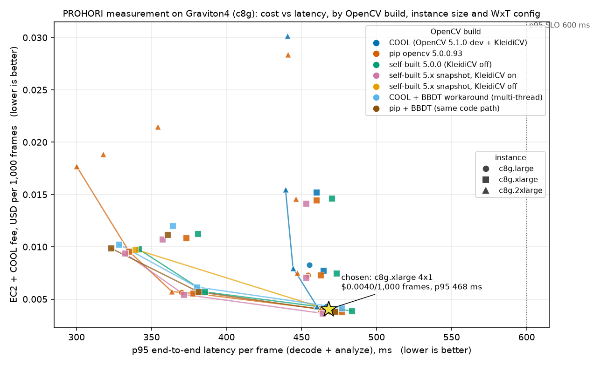

# COOL on Graviton4 runs PROHORI's measurement workload; it is not faster for it, and it is not bitwise identical to stock OpenCV

Run id `20261025T002750Z` (2026-10-25), repo base commit `60e3090`, tasks D24 (COOL runs the core workload), D25 (measured value, accuracy
invariance), D26 (instance-size and cost Pareto).  Everything below is regenerated from the raw JSON in this folder by
`python eval/cool_bench.py compare ...` and `python eval/cool_plot.py ...`; commands are in `research/COOL_NOTES.md`.

## 0. The answer in six lines

1. **Verified**: COOL (AMI `ami-033e481a24f94c8cb`, OpenCV **5.1.0-dev**, `-mcpu=neoverse-v2`, KleidiCV 0.7.0) executes PROHORI's full core
   measurement workload (decode, ChArUco board detection, homography, rectification, locator, full-resolution ROI warps, width
   estimators, gate) on a c8g.xlarge, c8g.large and c8g.2xlarge, for all 85 test frames.  Two compatibility facts: it ships **no
   opencv_contrib**, so `cv2.ximgproc.thinning` is replaced by a bit-exact numpy shim; and its default multithreaded
   `connectedComponentsWithStats` **crashes the process** (section 5).
2. **Speed**: end to end, COOL is **1.014x** [1.010, 1.017] faster than the stock pip OpenCV 5.0.0.93 wheel at 1 thread (c8g.large 0.997x,
   c8g.2xlarge 0.999x), i.e. break-even.  Of that, upstream changes and KleidiCV explain the gain; COOL's own tuning adds nothing.
3. **Why so small**: OpenCV calls are 67 % of `analyze()` time, and COOL speeds that share by only 1.01x, because the calls that dominate
   (resize INTER_AREA, ChArUco detection, warpPerspective, GaussianBlur) are not the ones KleidiCV accelerates (medianBlur, erode, one warp flavour).
   Even a 2x faster OpenCV would give 1.50x end to end.
4. **Cost**: the COOL software fee makes COOL **6.8 % more expensive per 1,000 frames than the stock wheel on c8g.xlarge** (13 % on c8g.large, 6.4 % on
   c8g.2xlarge) at list price, with identical throughput.
5. **Faithfulness**: widths are **not bitwise identical** to pip (max 0.030 mm, P99 0.015 mm, 1 borderline certification flip in 220 cracks), but two
   plain builds of the *same* 5.0.0 source differ by the same amount (compiler noise), the error against the printed ground truth is the same in
   every build, and a self-built 5.0.0 and a self-built 5.1-dev snapshot are bitwise identical.
6. **Workaround**: routing `connectedComponentsWithStats` to `CCL_BBDT` (bit-identical labels, stats and widths) lets COOL run with 4 threads:
   single-frame latency p50 183 ms vs 190 ms for pip at 4 threads (1.036x p50, CI includes 1.0) and 305 ms at 1 thread.

## 1. What was verified (evidence)

| item | value | evidence file |
|---|---|---|
| AMI | `ami-033e481a24f94c8cb` `Graviton5-COOL-v3-prod-k6u24vxijyzvg`, Marketplace product `prod-k6u24vxijyzvg` (code `aajkmdd4qo3r7yhqg61a7aah9`), us-east-1, created 2026-07-15, subscribed under the 7-day trial | `c8g.xlarge/evidence/cool_verify.txt` |
| Instances | c8g.large, c8g.xlarge, c8g.2xlarge (Neoverse-V2, Graviton4), Ubuntu 24.04.3, kernel 6.17.0-1019-aws, IMDSv2 confirmed type and AMI id on each | `*/evidence/cool_verify.txt`, `ledger.tsv` |
| Library | `cv2 5.1.0-dev` from `/opt/cool/python_3.12/site-packages/cv2/python-3.12/`, libs `/opt/cool/cpp_sdk/lib/libopencv_*.so.501`, Release `-O3 -mcpu=neoverse-v2`, libjpeg-turbo 3.1.2, pthreads, HAL `carotene 0.0.1 + KleidiCV 0.7.0`, ArmPL 25.07.1 rpath, GCC 13.3.0, `Version control: unknown`, timestamp 2026-07-13T03:56:14Z | `c8g.xlarge/cool/cool.build_info.txt` |
| Python environment | `/opt/cool/venvs/python_3.12` has **no cv2 of its own**; its `activate` exports `PYTHONPATH` and `LD_LIBRARY_PATH` that make cv2 importable (`infra/cool_remote.sh` reproduces them) | `c8g.xlarge/evidence/cool_verify.txt` |
| "COOL 3.1" label | **not provable from the AMI**: no version file exists under `/opt/cool`; the README there says "COOL build (OpenCV 5.1.0) vs standard tag build (OpenCV 5.0.0)" | same |
| Missing | no `opencv_contrib` (`cv2.ximgproc` absent); aruco/objdetect present | same |
| Other AMI | `ami-01db31139bc5615d8` (COOL v2) is OpenCV **4.14.0-pre**, TBB, no KleidiCV: rejected | `inspect_v2_ami/` |
| COOL really ran the workload | every `cool*` run's `*.bench.json` records `cv2_file` under `/opt/cool/...`, the 85 frames' results, and per-call timings from the COOL library; the per-call speedups in section 3 (medianBlur 2.4x, erode 1.75x, distanceTransform 1.65x) exist only in COOL/KleidiCV builds | `c8g.xlarge/cool/cool.bench.json` |
| Baselines on the same instance | stock `opencv-contrib-python-headless==5.0.0.93` (gcc 14.2, no KleidiCV); OpenCV 5.0.0 + contrib 5.0.0 built from source (gcc 13.3, `-O3`, NEON, KleidiCV off); upstream `5.x` at COOL's build timestamp, commit `8fdf15e`, KleidiCV 26.03 on and off, no contrib.  Same numpy 2.5.1 everywhere.  cmake commands and resolved flags are published | `c8g.xlarge/evidence/ref_*` |
| Inputs | 85 frames: 29 real phone photos of the printed panel (12 MP), 6 committed demo photos, 50 synthetic renders (12 MP); sha256 manifest in every `*.bench.json` | `*/*/*.bench.json` (`inputs`) |

## 2. Accuracy invariance (D25)

Method: every leaf of every result (crack widths, all estimator columns, uncertainties, gate fields, corners) dumped as float64 hex; compared crack by
crack (matched by crack id); first differing OpenCV call found by hashing every call output.

| pair | bitwise identical | leaves differing | cracks with |dw| > 0 at 0.0001 mm | max / P99 / mean abs(dw) mm | certification flips | first differing OpenCV call | mean abs error vs truth, A / B (mm) | paired mean abs-error change B-A [95% CI] (mm) |
|---|---|---|---|---|---|---|---|---|
| pip vs self-built 5.0.0 | no | 2449 / 10183 | 159 / 220 | 3.0e-02 / 5.8e-03 / 6.7e-04 | 0 | cv2.findHomography | 0.1218 / 0.1220 | +0.00016 [-0.00013, +0.00056] |
| self-built 5.0.0 vs 5.x snapshot (KleidiCV off) | **yes** | 0 / 10182 | 0 / 220 | 0.0e+00 / 0.0e+00 / 0.0e+00 | 0 | None | 0.1220 / 0.1220 | +0.00000 [+0.00000, +0.00000] |
| snapshot KleidiCV off vs on | no | 203 / 10182 | 6 / 220 | 3.0e-04 / 1.0e-04 / 3.6e-06 | 0 | cv2.warpPerspective | 0.1220 / 0.1220 | +0.00000 [-0.00000, +0.00000] |
| pip: numpy thinning shim vs native ximgproc | **yes** | 0 / 10183 | 0 / 220 | 0.0e+00 / 0.0e+00 / 0.0e+00 | 0 | None | 0.1218 / 0.1218 | +0.00000 [+0.00000, +0.00000] |
| pip vs COOL | no | 2391 / 10184 | 154 / 220 | 3.0e-02 / 1.5e-02 / 7.2e-04 | 1 | cv2.findHomography | 0.1218 / 0.1219 | +0.00010 [-0.00024, +0.00053] |
| self-built 5.0.0 vs COOL | no | 2582 / 10183 | 157 / 220 | 1.5e-02 / 4.7e-03 / 5.3e-04 | 1 | cv2.findHomography | 0.1220 / 0.1219 | -0.00005 [-0.00026, +0.00017] |
| snapshot KleidiCV off vs COOL | no | 2582 / 10183 | 157 / 220 | 1.5e-02 / 4.7e-03 / 5.3e-04 | 1 | cv2.findHomography | 0.1220 / 0.1219 | -0.00005 [-0.00026, +0.00017] |
| snapshot KleidiCV on vs COOL | no | 2577 / 10183 | 157 / 220 | 1.5e-02 / 4.7e-03 / 5.3e-04 | 1 | cv2.findHomography | 0.1220 / 0.1219 | -0.00005 [-0.00027, +0.00017] |

Reading the ladder:

- **COOL is not bitwise identical to pip**: 154 of 220 cracks differ at the reported 0.0001 mm precision; max |dw| 0.030 mm, P99 0.015 mm; the first
  differing call is `cv2.findHomography`, and everything downstream inherits it.
- **That is build noise, not COOL**: a self-built OpenCV from the *same* 5.0.0 source (different compiler: gcc 13.3 vs the wheel's 14.2) differs from pip by the same
  amount (max 0.030, P99 0.0058 mm, first differing call `findHomography`).  Self-built 5.0.0 vs self-built 5.1-dev snapshot (both KleidiCV off, same compiler) is **bitwise identical** over all 10,182
  leaves, so the 5.0 -> 5.1 library change is not a cause.  KleidiCV on vs off changes widths by at most 0.0003 mm.  What is left for COOL is its compile flags
  (`-mcpu=neoverse-v2`) and its own HAL: differences of the size you get between any two compilers.
- **Accuracy is the same**: mean |error| against the printed ground truth over 220 cracks is 0.1218 mm (pip), 0.1220 (self-built), 0.1219 (COOL);
  paired COOL minus pip +0.0001 mm [-0.00024, +0.00053].  On c8g.large (120 cracks) +0.0005 mm [-0.00002, +0.0013], on c8g.2xlarge the same data.
- **Certification**: one flip in 220 cracks, `samples/tilted.jpg` crack C5: pip risk_ratio 0.822 (certified) vs COOL 0.947 (flagged, reason `unstable_width`),
  threshold 0.893 at level 0.05, width 0.9003 vs 0.9002 mm.  A borderline crack whose score moves 0.12 on a 0.0001 mm width change; the gate has a steep edge there.
  No frame lost or gained a crack.
- **U_ref = 0.009 mm**: the *typical* difference is far below it (mean 0.0007 mm, P99 0.015 mm vs pip, 0.0047 mm vs a same-compiler build), but the worst
  cracks (max 0.030 mm) exceed it, in the same way as pip vs a rebuilt pip does.  The strict "bitwise identical" bar in METRICS section 5 is **not met** for COOL vs the pip
  wheel; it is met between any two builds with the same compiler flags.  The honest statement is "within build-to-build floating-point noise".
- **The shims are exact**: numpy thinning vs native `ximgproc.thinning` on the pip build, all 85 frames: bitwise identical (0 / 10,183 leaves differ).  The BBDT swap: bitwise identical on pip and on COOL (0 / 5,471 and 0 / 5,472 leaves, 43 frames).
- Within-build determinism: every build returns the same result on every repetition.

## 3. Speed (D25)

Setup: c8g.xlarge, 85 frames x 5 timed passes after 1 warm-up, 1 OpenCV thread (the only setting COOL can run unmodified), un-instrumented, `decode + analyze`.
Speedup = A time / COOL time, ratio of pooled means (p50 and p95 below) with a paired image-cluster bootstrap (2,000 resamples) 95 % CI.

| stage | COOL p50 / p95 ms | speedup vs pip 5.0.0.93 (mean, 95% CI) | speedup vs self-built 5.0.0 (mean, 95% CI) | speedup vs self-built 5.x snapshot, KleidiCV off (mean, 95% CI) |
|---|---|---|---|---|
| decode | 52.0 / 67.1 | 0.987 [0.969, 1.008] | 1.003 [0.991, 1.014] | 1.003 [0.989, 1.016] |
| detect | 74.1 / 94.5 | 1.018 [1.012, 1.024] | 1.046 [1.043, 1.050] | 0.919 [0.907, 0.931] |
| rectify | 78.5 / 90.7 | 1.046 [1.042, 1.051] | 1.050 [1.047, 1.054] | 1.071 [1.067, 1.075] |
| measure | 42.9 / 191.3 | 0.987 [0.984, 0.990] | 0.993 [0.990, 0.997] | 1.004 [1.000, 1.008] |
| other | 52.3 / 69.5 | 1.028 [1.025, 1.031] | 1.024 [1.020, 1.027] | 1.031 [1.027, 1.034] |
| analyze | 260.4 / 398.5 | 1.019 [1.016, 1.021] | 1.029 [1.027, 1.031] | 1.003 [1.000, 1.006] |
| e2e | 310.2 / 453.5 | 1.014 [1.010, 1.017] | 1.025 [1.022, 1.027] | 1.003 [0.999, 1.007] |

p50 and p95 speedups of the end-to-end latency: vs pip 5.0.0.93: p50 1.022 [1.000, 1.038], p95 1.021 [0.998, 1.028]; vs self-built 5.0.0: p50 1.024 [1.011, 1.034], p95 1.028 [1.015, 1.031]; vs self-built 5.x snapshot, KleidiCV off: p50 1.005 [0.982, 1.016], p95 1.016 [1.003, 1.021]

### 3.1 Where the gain comes from (ladder, one change at a time)

| step (A -> B) | e2e speedup A/B (mean, 95% CI) | analyze() | OpenCV-call time A/B | Python/numpy time A/B | OpenCV share of analyze (A -> B) |
|---|---|---|---|---|---|
| pip 5.0.0.93 -> self-built 5.0.0 (same source, other compiler) | 0.989 [0.986, 0.993] | 0.990 | 0.970 | 1.033 | 66.8 % -> 68.2 % |
| self-built 5.0.0 -> self-built 5.x snapshot (library version only, KleidiCV off) | 1.022 [1.019, 1.025] | 1.026 | 1.040 | 0.996 | 68.2 % -> 67.2 % |
| snapshot KleidiCV off -> on (KleidiCV only) | 1.011 [1.007, 1.015] | 1.015 | 1.028 | 0.990 | 67.2 % -> 66.4 % |
| snapshot KleidiCV on -> COOL (COOL's own build/tuning only) | 0.992 [0.987, 0.996] | 0.988 | 0.974 | 1.017 | 66.4 % -> 67.4 % |
| pip 5.0.0.93 -> COOL (the claim) | 1.014 [1.010, 1.017] | 1.019 | 1.010 | 1.036 | 66.8 % -> 67.4 % |
| COOL -> COOL repeated later (drift) | 0.993 [0.990, 0.995] | 0.995 | n/a | n/a | n/a |

COOL's end-to-end edge over pip (1.4 %) is the sum of: a different compiler (-1.1 %), upstream 5.0 -> 5.1-dev library changes (+2.2 %), KleidiCV (+1.1 %), and COOL's own
tuning on top (-0.8 %).  A second COOL run later on the same box differs by 0.7 %.  The confidence intervals are bootstrap intervals over images, not over machines or time, so they
understate the real uncertainty: treat anything within about +-2 % as a tie.  Replications: c8g.large COOL/pip e2e 0.997x [0.993, 1.001]; c8g.2xlarge 0.999x [0.993, 1.005].

### 3.2 Amdahl: the OpenCV share is 67 %, and COOL does not accelerate the big calls

OpenCV-call time (timed per call inside the trace pass) over the un-instrumented `analyze()` time of the same 85 frames: **66.8 % (pip), 67.4 % (COOL)**.  COOL speeds the OpenCV
share by 1.010x (Python/numpy and the thinning shim: 33 %, unchanged).  Predicted end-to-end gain 1.007x; even a 2x faster OpenCV would give 1.50x.  (cProfile, a second
method, agrees: cv2 63.9 %, python 20.2 %, numpy 13.9 %, other 2.0 % of self time.)  At 4 OpenCV threads the OpenCV share of the pip build falls to 47 % (OpenCV time 3.3 s of 7.1 s for 43 frames), so the
Python part matters more the more threads are used.

Per-call microbenchmark of the exact calls at the sizes the pipeline uses, 1 thread, median ms (full table incl. 4 threads: `analysis/pip__vs__cool.md`):

| OpenCV call (pipeline size) | pip 5.0.0.93 ms | 5.x snapshot, KleidiCV off | 5.x snapshot, KleidiCV on | COOL | COOL vs pip | KleidiCV on vs off | COOL vs snapshot+KleidiCV | output bytes identical (pip = COOL) |
|---|---:|---:|---:|---:|---:|---:|---:|---|
| imdecode_jpeg_12MP 4096x3072 | 59.994 | 64.923 | 63.969 | 62.909 | 0.95x | 1.01x | 1.02x | yes |
| cvtColor_BGR2GRAY 4096x3072x3 | 3.816 | 3.599 | 3.558 | 3.729 | 1.02x | 1.01x | 0.95x | yes |
| resize_AREA_grey_x0.5 4096x3072 | 0.642 | 0.604 | 0.528 | 0.526 | 1.22x | 1.14x | 1.00x | yes |
| resize_AREA_grey_x0.3 4096x3072 | 16.023 | 17.558 | 17.775 | 16.141 | 0.99x | 0.99x | 1.10x | yes |
| resize_LINEAR_f32_up 318x450->1273x1800 | 0.744 | 0.774 | 0.751 | 0.748 | 1.00x | 1.03x | 1.00x | no |
| warpPerspective_LINEAR_u8 1229x922->1273x1800 | 4.797 | 4.999 | 8.111 | 8.636 | 0.56x | 0.62x | 0.94x | no |
| warpPerspective_NEAREST_u8 1229x922->1273x1800 | 2.691 | 2.745 | 2.319 | 2.113 | 1.27x | 1.18x | 1.10x | no |
| warpPerspective_CUBIC_u8_ROI 4096x3072->2000x500 | 5.949 | 5.997 | 5.988 | 6.115 | 0.97x | 1.00x | 0.98x | yes |
| warpPerspective_NEAREST_u8_ROI_valid 4096x3072->2000x500 | 1.439 | 1.514 | 1.209 | 1.113 | 1.29x | 1.25x | 1.09x | yes |
| erode_7x7_u8 1273x1800 | 0.806 | 0.679 | 0.470 | 0.460 | 1.75x | 1.44x | 1.02x | yes |
| erode_5x5_u8_ROI 2000x500 | 0.228 | 0.200 | 0.151 | 0.148 | 1.54x | 1.32x | 1.02x | yes |
| GaussianBlur_u8_sigma0.7 1273x1800 | 2.499 | 2.621 | 2.581 | 2.636 | 0.95x | 1.02x | 0.98x | yes |
| GaussianBlur_f32_sigma4 2000x500 | 5.371 | 5.385 | 5.278 | 5.274 | 1.02x | 1.02x | 1.00x | yes |
| GaussianBlur_f32_sigma3_sigmaY0 71x220 | 0.069 | 0.071 | 0.071 | 0.072 | 0.96x | 1.00x | 0.99x | yes |
| dilate_f32_rect 2000x500 k=17 | 1.778 | 1.814 | 1.799 | 1.772 | 1.00x | 1.01x | 1.02x | yes |
| medianBlur_u8_k15 318x450 | 7.478 | 7.470 | 3.276 | 3.092 | 2.42x | 2.28x | 1.06x | yes |
| morphologyEx_close_ellipse 1273x1800 | 0.634 | 0.650 | 0.640 | 0.639 | 0.99x | 1.02x | 1.00x | yes |
| connectedComponentsWithStats 1273x1800 | 6.970 | 6.913 | 6.913 | 6.339 | 1.10x | 1.00x | 1.09x | yes |
| ximgproc_thinning 1884x204 | 2.826 | 2.771 | 2.762 | 2.761 | 1.02x | 1.00x | 1.00x | yes |
| distanceTransform_L2_precise 1884x204 | 2.310 | 2.269 | 2.294 | 1.393 | 1.66x | 0.99x | 1.65x | yes |
| remap_f32_LINEAR_profiles 71x220 from 2000x500 | 0.041 | 0.039 | 0.038 | 0.037 | 1.13x | 1.02x | 1.03x | yes |
| findContours_CCOMP 1884x204 | 0.075 | 0.078 | 0.078 | 0.060 | 1.24x | 1.00x | 1.30x | yes |
| Laplacian_f32 1273x1800 | 2.762 | 2.795 | 2.788 | 2.776 | 0.99x | 1.00x | 1.00x | yes |
| findHomography_RANSAC 112 pts | 1.307 | 1.400 | 1.406 | 1.413 | 0.93x | 1.00x | 1.00x | no |
| pipeline_bg_map_f32 2000x500 | 2.579 | 2.652 | 3.284 | 3.465 | 0.74x | 0.81x | 0.95x | no |
| pipeline_detect_board 4096x3072 (real photo) | 75.569 | 69.031 | 67.451 | 72.512 | 1.04x | 1.02x | 0.93x | yes |

- **Winners** (bit-exact, so free): `medianBlur` 2.4x and `erode` 1.5-1.75x and `warpPerspective` NEAREST 1.3x (all KleidiCV, they also exist in the upstream snapshot build); COOL's own
  additions: `distanceTransform` 1.65x, `findContours` 1.3x, `connectedComponents` 1.09x, AREA resize 1.1x.
- **Losers**: `warpPerspective` INTER_LINEAR is **0.56x** (KleidiCV regression, 4.8 -> 8.6 ms); the pipeline's `_bg_map` float path 0.74x; ChArUco `detectBoard` 0.93x vs upstream; `imdecode` 0.95x.
- **Unaccelerated and big**: `resize` INTER_AREA from 12 MP (16 ms per call, 17 % of the pipeline), `detectBoard` (17 %), `warpPerspective` CUBIC (6 ms per ROI), `GaussianBlur`: identical on all builds.
- At 4 threads (microbench, 4 threads): resize AREA x0.5 4.15x, medianBlur 4.4x, erode 1.76x, distanceTransform 1.67x, in-pipeline stages detect 1.076x, rectify 1.155x (section 5.2).

### 3.3 Throughput and latency sweep (c8g.xlarge)

WxT = W worker processes, each `cv2.setNumThreads(T)`; every frame decoded and analysed; fps = frames / wall time; p95 is per-frame under that load.  COOL crashes at any T >= 2 with the default CCL.

| config (workers x threads) | cool | pip | ref | snap_kon | snap_koff |
|---|---|---|---|---|---|
| 1x1 | 3.10 fps, p95 460 ms | 3.06 fps, p95 460 ms | 3.03 fps, p95 470 ms | 3.13 fps, p95 453 ms | not run |
| 1x2 | **crashed** | 4.09 fps, p95 373 ms | 3.94 fps, p95 381 ms | 4.13 fps, p95 357 ms | not run |
| 1x4 | **crashed** | 4.63 fps, p95 335 ms | 4.53 fps, p95 341 ms | 4.73 fps, p95 332 ms | 4.54 fps, p95 339 ms |
| 2x1 | 6.09 fps, p95 465 ms | 6.06 fps, p95 463 ms | 5.95 fps, p95 473 ms | 6.27 fps, p95 453 ms | not run |
| 4x1 | 11.69 fps, p95 468 ms | 11.75 fps, p95 477 ms | 11.43 fps, p95 483 ms | 12.15 fps, p95 464 ms | 11.71 fps, p95 472 ms |
| 2x2 | **crashed** | 7.97 fps, p95 378 ms | 7.79 fps, p95 386 ms | 8.14 fps, p95 372 ms | not run |

4 processes x 1 thread (11.7 fps) scale 3.8x over 1 process x 1 thread and are the cheapest per frame for every build.  COOL = pip within 1 % in every configuration it can run.
On c8g.large: 1x1 3.02 vs 3.04 fps, 2x1 5.76 vs 5.80; on c8g.2xlarge: 8x1 21.78 vs 21.82 fps.

## 4. Cost (D26)

List prices, AWS Price List API (us-east-1, Linux, shared tenancy, published 2026-10-23): c8g.large $0.07976/h, c8g.xlarge $0.15952/h, c8g.2xlarge $0.31904/h.  COOL software fee $0.01/h (large, xlarge), $0.02/h
(2xlarge); **waived during the 7-day trial, charged here at list price**.  Cost per 1,000 frames = (USD/h) / 3600 x 1000 / fps, at saturation (every config measured as above); `cost_table.csv` has all 48 rows.

| instance | best config | COOL USD / 1,000 frames | pip USD / 1,000 frames | COOL premium |
|---|---|---|---|---|
| c8g.large | 2 procs x 1 thread | 0.00433 | 0.00382 | +13.4 % |
| c8g.xlarge | 4 x 1 | 0.00403 | 0.00377 | +6.8 % |
| c8g.2xlarge | 8 x 1 | 0.00432 | 0.00406 | +6.4 % |

- **COOL is about 7 % more expensive per frame for this workload today** (13 % on the smallest size, where the flat $0.01/h is 12.5 % of the instance price), because it buys no throughput.
- Chosen production configuration (cheapest COOL config with p95 <= 600 ms): **c8g.xlarge, 4 processes x 1 thread, $0.0040 per 1,000 frames, p95 468 ms** (the star).  c8g.large 2x1 costs $0.0043 for 5.8 fps; with the BBDT workaround 1 process x 4 threads costs $0.0102 per 1,000 frames but
  answers in p50 186 ms instead of 327 ms.
- A live judge endpoint is idle almost all the time: the real cost is instance-hours (c8g.large + COOL fee = $0.0898/h = $2.15/day), not frames.

## 5. The crash, and the workaround

### 5.1 Crash (bug report draft: `bug_connectedcomponents/README.md`)

`cv2.connectedComponentsWithStats(mask, connectivity=8)` (default algorithm CCL_SPAGHETTI) on a 1800x1273 uint8 mask aborts the process with a glibc heap-corruption
message as soon as OpenCV uses 2 or more threads.  The AMI's default is the vCPU count, so **PROHORI's first frame kills the process at default settings**.

| build (same c8g.xlarge) | 1 thread | 2 threads | 4 threads |
|---|---|---|---|
| COOL 5.1.0-dev | 0 / 50 | **50 / 50** | **50 / 50** |
| pip 5.0.0.93, self-built 5.0.0, upstream 5.x snapshot KleidiCV on, snapshot KleidiCV off | 0 / 50 | 0 / 50 | 0 / 50 |

COOL-specific (not upstream 5.1-dev, not KleidiCV as upstream builds it).  COOL with 4 threads: connectivity 4, BBDT and WU: 0 / 50; SPAGHETTI: 50 / 50.  Standalone repro, mask, matrix, gdb output: `bug_connectedcomponents/`.  Not reported anywhere.

### 5.2 The workaround: `CCL_BBDT`

`cool_compat.install_thinning(measure, "auto", "bbdt")` routes the call to `connectedComponentsWithStatsWithAlgorithm(..., CCL_BBDT)` (harness only; `measure.py` untouched).
BBDT returns identical labels, stats and centroids on all 63 masks PROHORI produces (WU does not: 5 of 63 differ).  Pipeline output with the swap is **bitwise identical** on pip and on COOL at 1 thread, and the swap costs no time (1.000x).
With it COOL runs at 4 threads without crashing.  c8g.xlarge, 1 process, 43 frames (`ccl_c8g.xlarge/`):

| run (1 process, 43 frames x 3-5 reps) | threads | CCL | e2e p50 ms | e2e p95 ms | e2e mean ms | analyze mean ms |
|---|---|---|---|---|---|---|
| pip, 1 thread, default CCL | 1 | default | 304 | 454 | 317 | 268 |
| COOL, 1 thread, default CCL | 1 | default | 305 | 451 | 316 | 265 |
| pip, 1 thread, BBDT | 1 | bbdt | 303 | 452 | 316 | 270 |
| COOL, 1 thread, BBDT | 1 | bbdt | 305 | 451 | 316 | 265 |
| pip, 4 threads, default CCL | 4 | default | 190 | 331 | 209 | 165 |
| pip, 4 threads, BBDT | 4 | bbdt | 190 | 331 | 211 | 164 |
| COOL, 4 threads, BBDT (default CCL crashes) | 4 | bbdt | 183 | 322 | 205 | 155 |

| comparison (A -> B) | stage | A p50 / p95 ms | B p50 / p95 ms | speedup A/B mean [95% CI] | p50 | p95 |
|---|---|---|---|---|---|---|
| pip 4T default CCL -> COOL 4T BBDT | detect | 30 / 37 | 28 / 36 | 1.076 [1.063, 1.089] | 1.060 | 1.041 |
| pip 4T default CCL -> COOL 4T BBDT | rectify | 48 / 62 | 41 / 56 | 1.155 [1.144, 1.167] | 1.169 | 1.113 |
| pip 4T default CCL -> COOL 4T BBDT | measure | 28 / 151 | 29 / 151 | 0.990 [0.986, 0.994] | 0.979 | 0.995 |
| pip 4T default CCL -> COOL 4T BBDT | analyze | 147 / 272 | 136 / 261 | 1.065 [1.058, 1.073] | 1.078 | 1.041 |
| pip 4T default CCL -> COOL 4T BBDT | e2e | 190 / 331 | 183 / 322 | 1.019 [1.008, 1.030] | 1.036 | 1.028 |
| pip 4T BBDT -> COOL 4T BBDT | detect | 30 / 37 | 28 / 36 | 1.069 [1.058, 1.081] | 1.057 | 1.020 |
| pip 4T BBDT -> COOL 4T BBDT | rectify | 48 / 63 | 41 / 56 | 1.142 [1.132, 1.152] | 1.160 | 1.114 |
| pip 4T BBDT -> COOL 4T BBDT | measure | 28 / 150 | 29 / 151 | 0.991 [0.987, 0.995] | 0.976 | 0.994 |
| pip 4T BBDT -> COOL 4T BBDT | analyze | 144 / 272 | 136 / 261 | 1.057 [1.051, 1.063] | 1.056 | 1.041 |
| pip 4T BBDT -> COOL 4T BBDT | e2e | 190 / 331 | 183 / 322 | 1.026 [1.019, 1.034] | 1.038 | 1.027 |
| pip 1T -> pip 4T (default CCL) | detect | 72 / 89 | 30 / 37 | 2.382 [2.360, 2.401] | 2.421 | 2.369 |
| pip 1T -> pip 4T (default CCL) | rectify | 79 / 93 | 48 / 62 | 1.605 [1.569, 1.644] | 1.642 | 1.496 |
| pip 1T -> pip 4T (default CCL) | measure | 42 / 179 | 28 / 151 | 1.272 [1.235, 1.329] | 1.518 | 1.192 |
| pip 1T -> pip 4T (default CCL) | analyze | 254 / 395 | 147 / 272 | 1.624 [1.569, 1.693] | 1.731 | 1.452 |
| pip 1T -> pip 4T (default CCL) | e2e | 304 / 454 | 190 / 331 | 1.514 [1.472, 1.560] | 1.601 | 1.371 |

**Does COOL at 4 threads beat pip at 4 threads on a single frame?** Marginally: e2e p50 183 vs 190 ms (1.036x, CI [0.99, 1.06]), p95 322 vs 331 ms (1.028x), mean 1.019-1.026x with CI above 1.0.  The gain is in `rectify` (1.155x: medianBlur, erode, dilate on the 1/4-resolution
background map) and `detect` (1.076x), partly eaten by `decode` (0.88-0.93x, JPEG decode is single-threaded and not faster on COOL).  `measure` (ROI warps, GaussianBlur) is 0.99x.  Going from 1 to 4 threads is worth far more than the build: 304 -> 190 ms p50 (1.60x) for either.
Throughput configs with the workaround (c8g.xlarge): 1x4 4.60 fps (COOL) vs 4.49 (pip, same code path); 2x2 7.65 vs 7.77; 4x1 11.35 vs 11.56.  I could not measure per-call times *inside the pipeline* at 4 threads for COOL: the trace pass of that run
accidentally ran at 1 thread (a harness bug, fixed in `cool_bench.py` afterwards); the planned re-run could not be done because the AWS session expired.  The stage-level result and the isolated 4-thread microbench above are what exist.

## 6. What would make COOL pay for this workload (brief for the follow-up job)

Share of time = cProfile self time on COOL, 1 thread, 85 frames; "gain" = measured on COOL (single thread) in `c8g.xlarge/extras/cool.variants.json` (46-case flag/variant table) and the micro table.

| # | kind | function | file:line | calls | self ms/frame | share |
|---:|---|---|---|---:|---:|---:|
| 1 | cv2 | `<resize>` |  | 1065 | 49.59 | 17.4 % |
| 2 | cv2 | `<method 'detectBoard' of 'cv2.aruco.CharucoDetector' objects>` |  | 85 | 49.07 | 17.2 % |
| 3 | cv2 | `<warpPerspective>` |  | 1052 | 29.98 | 10.5 % |
| 4 | numpy | `<method 'reduce' of 'numpy.ufunc' objects>` |  | 105297 | 16.03 | 5.6 % |
| 5 | python | `thinning_zs` | /home/ubuntu/prohori/eval/cool_compat.py:39 | 848 | 12.23 | 4.3 % |
| 6 | cv2 | `<GaussianBlur>` |  | 1196 | 10.97 | 3.8 % |
| 7 | numpy | `<method 'partition' of 'numpy.ndarray' objects>` |  | 6526 | 8.04 | 2.8 % |
| 8 | cv2 | `<connectedComponentsWithStats>` |  | 302 | 7.65 | 2.7 % |
| 9 | python | `_longest_path` | /home/ubuntu/prohori/src/prohori/measure.py:297 | 848 | 7.13 | 2.5 % |
| 10 | python | `_locate_cracks` | /home/ubuntu/prohori/src/prohori/measure.py:369 | 77 | 7.02 | 2.5 % |
| 11 | cv2 | `<filter2D>` |  | 77 | 6.51 | 2.3 % |
| 12 | python | `_measure_roi` | /home/ubuntu/prohori/src/prohori/measure.py:565 | 372 | 5.66 | 2.0 % |
| 13 | cv2 | `<Sobel>` |  | 154 | 5.21 | 1.8 % |
| 14 | python | `_prepare` | /home/ubuntu/prohori/src/prohori/measure.py:1048 | 85 | 5.01 | 1.8 % |
| 15 | python | `bfs` | /home/ubuntu/prohori/src/prohori/measure.py:320 | 1696 | 4.77 | 1.7 % |

Top cv2 entries:

| call / where | current call and flags | share | COOL today | faster variant on COOL (measured) | gain | changes outputs? |
|---|---|---|---|---|---|---|
| `resize` 12 MP -> ~0.3x (detect input, locator canvas, edge sigma) | `INTER_AREA`, fx=0.3 | 17.4 % (12.5 calls/frame) | 16.3 ms, same as pip | `INTER_LINEAR` 2.29 ms, `NEAREST` 0.76 ms; at exactly 0.5x `INTER_AREA` 0.60 ms and `INTER_LINEAR` 0.585 ms | up to 7x per big call | LINEAR/NEAREST: **yes** (aliasing); an exact 0.5x or 0.25x (two 0.5x steps) is cheap but changes the sampling grid, so retune and re-validate |
| `aruco.CharucoDetector.detectBoard` | `DETECT_MAX_SIDE=2000` | 17.2 % | 0.93x of upstream | none at call level; 4 threads 2.4x (72 -> 30 ms); fewer pixels (`DETECT_MAX_SIDE` 1000) | 4 threads: 2.4x | threads: no; smaller image: yes |
| `warpPerspective` rectified canvas | `INTER_LINEAR`, uint8 | 10.5 % (all warps) | **8.6 ms vs 4.8 ms pip (KleidiCV regression)** | `remap` with precomputed `CV_16SC2` maps 3.33 ms; f32 maps 5.1 ms; `INTER_NEAREST` 2.1 ms | 2.6x vs COOL's warp, 1.4x vs pip's | 16SC2 / f32 / NEAREST: **yes** (fixed-point sampling, tiny pixel differences); map build costs numpy time |
| `warpPerspective` full-res ROI | `INTER_CUBIC`, 12 MP source | in the 10.5 % | 6.1 ms on every build | `remap` CUBIC 4.67 ms; `INTER_LINEAR` 3.8 ms | 1.3x / 1.6x | yes |
| `GaussianBlur` (u8 sigma 0.7; f32 sigma 4) | `(0,0), sigma` | 3.8 % | 2.6 / 5.3 ms, same as pip | `sepFilter2D` same speed | none | n/a |
| `connectedComponentsWithStats` | conn 8, default (SPAGHETTI) | 2.7 % | 6.3 ms; **crash at >= 2 threads** | `CCL_BBDT` 6.1 ms | 1.04x, enables threads | **no** (identical on 63 masks) |
| `distanceTransform` | `DIST_L2, MASK_PRECISE` | 0.5 % | 1.39 ms (1.65x faster than pip already) | `DIST_MASK_5` 0.58 ms | 2.4x | **yes** (approximation changes widths) |
| `medianBlur` k=15, `erode` 7x7 | as is | 1.5 % + 0.3 % | 2.4x / 1.75x faster already | none needed | | no |
| `imdecode` + `cvtColor` | `IMREAD_COLOR`, BGR2GRAY | 18 % of e2e (59 ms) | 0.95x of pip | `IMREAD_GRAYSCALE` 31.8 ms | 1.86x | **yes on real photos** (0.03 % of pixels differ by up to 5 grey levels, checked on `IMG20261019080657.jpg`; exact on the synthetic frame) and the service needs colour for the overlay |
| Python: `thinning_zs` (shim for the missing ximgproc) | numpy Zhang-Suen, sparse | 4.3 % (12 ms/frame) | native thinning does not exist on COOL | express the 8-neighbour LUT test as `filter2D` + `LUT` iterations (OpenCV kernels) or a C++ ZS | est. 2-4x | no (bit-exact by construction; verify) |
| Python/numpy: `ufunc.reduce` 5.6 %, `partition` (median/percentile) 2.8 %, `_longest_path` + `bfs` 4.2 %, `_locate_cracks` 2.5 % | per-station Python loops | ~15 % | same as pip | move to vectorised or OpenCV kernels | limited by the 33 % Python share | no if done exactly |

A 2x faster OpenCV is worth 1.50x end to end at most; multithreading (1.6x at 4 threads) is the bigger lever, and it requires the BBDT workaround or a fixed COOL.

## 7. Threats to validity

- **Version**: COOL here is 5.1.0-dev with no provable "3.1"; the comparison to pip 5.0.0.93 mixes library version, compiler and HAL, which is why the ladder exists.  The upstream snapshot build is the commit at COOL's timestamp (`8fdf15e`), not COOL's exact source (its `Version control` is unknown) and uses KleidiCV 26.03 where COOL ships 0.7.0.
- **One machine per cell**: each build ran on one instance, back to back (COOL, pip, pip native, self-built, COOL repeat, snapshots).  Bootstrap CIs resample frames, not machines or time; COOL-vs-itself drift was 0.7 %, and compiler-only change moved e2e 1.1 %, so differences under about 2 % are not distinguishable.  Replicates on c8g.large and c8g.2xlarge agree (0.997x, 0.999x).
- **Workload definition**: the headline uses a numpy thinning shim in every build (slower than native by ~12 ms/frame, 4 % of the frame, equal across builds); native-thinning runs exist for pip and self-built (`pip_native`, `ref_native`, 3 reps) and give bitwise identical results.  One-thread runs only for the headline, because COOL cannot run more by default.
- **Inputs**: one phone, one printed panel (29 photos), six demo photos, 50 renders; the size and sweep sessions used a stride-2 subset (43 frames) and the xlarge sweep a stride-2 subset of 85.  Error against "truth" is the nominal printed width, not an independent measurement.
- **Instrumentation**: the trace pass and cProfile slow the code; shares use OpenCV time measured inside the call over the un-instrumented total and agree with cProfile (67 % vs 64 %).  The "Python/numpy A/B" column in the ladder includes about +-3 % noise because it is a difference of two totals.  The 4-thread Amdahl split for COOL is missing (harness bug, section 5.2).
- **Cost model**: list prices, saturated throughput, no EBS, data transfer or t4g front; the COOL fee is waived during the 7-day trial and may not be payable with credits (see DOSSIER).
- **Crash root cause** is not identified (no symbols; gdb cannot unwind a corrupt stack; valgrind aborts in COOL's static initialisers).  It was reproduced in 100 / 100 runs at >= 2 threads, so it is robust, but the exact trigger (mask shape) is only partly characterised.
- **Termination check**: each session script terminated its instance on exit and waited for `instance-terminated` (ledger below).  The last explicit `describe-instances` for `Purpose=cool-bench` could not be repeated after the AWS session expired; the final planned run (a 4-thread trace session) never launched (`RunInstances` expired).

## 8. Instance time and cost

`ledger.tsv`: 8 launches, **2.198 instance-hours** (cap 4): main c8g.xlarge session 1.28 h, c8g.xlarge CCL session 0.285 h, two c8g.large sweep attempts 0.091 + 0.179 h (the first failed on a missing file in the bundle), c8g.2xlarge 0.142 h, two aborted starts and the v2-AMI inspection 0.221 h.
EC2 on-demand about $0.35, COOL fee at list price about $0.02 (waived in the trial): **about $0.37**.

## 9. Files

`c8g.large/ c8g.xlarge/ c8g.2xlarge/ ccl_c8g.xlarge/` (per build: `*.bench.json` raw timings, `*.inv.json.gz` hex dumps, `*.build_info.txt`, `*.env.json`), `c8g.xlarge/evidence/` (COOL verification, cmake commands, commits, versions),
`c8g.xlarge/extras/` (cProfile, variants, crash matrix), `analysis/` (every pairwise comparison as .md/.json and the tables above), `bug_connectedcomponents/`, `repro/`, `pareto.png`, `cost_table.csv`, `cost_summary.json`, `prices.json`, `../ledger.tsv`, `verify_v3_ami_attempt1/`, `inspect_v2_ami/`, `failed_attempt_c8g.large_missing_module/` (kept as an honest record).
