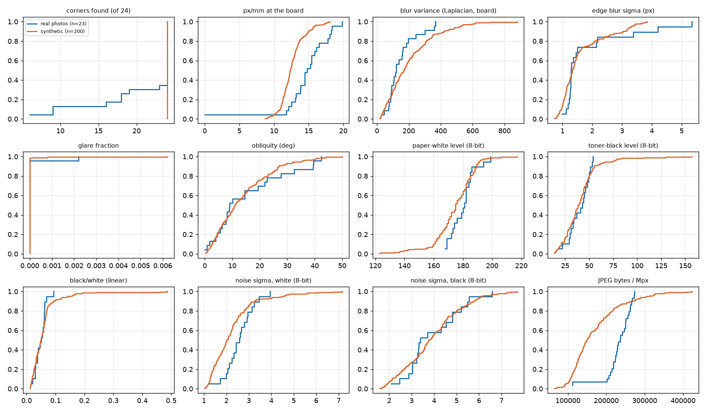
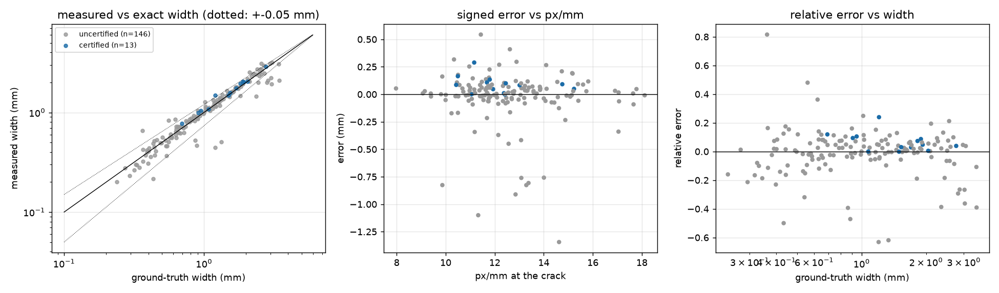

# Synthetic generator: realism and width error (D11)

*`src/prohori/measure.py` as of 2026-10-19 18:35 (sha1 `2529dfc6cd`); the gate and width numbers below describe that version.*

Generated by `eval/synth_validation.py` on 200 renders of `data\synth\v1` (seeds as in `config.json`) and the 29 real panel photos in `data/raw`. All photos go through the same `measure.analyze(panel_mode=False)`; the renders contain a printed ChArUco board on a white sheet next to one real-mask crack on a concrete/plaster texture, so the board is the only region that real and synthetic photos share. Board statistics are therefore compared on the rectified board (12 px/mm), obs-vector fields on the whole image.

## Headline

- Board found (>= 6 corners): **200/200** renders (100%); real photos: 23/29.
- Certified by the gate of the `measure.analyze` that was installed at run time (see the header; its reasons include the corner / px-per-mm / blur / obliquity / glare thresholds and the mask-quality and width-stability checks): **15/200** (8%).  Reasons among uncertified: `unstable_width` 148, `mask_holes` 71, `mask_blowup` 47, `low_resolution` 38, `mask_fragmented` 21, `blurry` 16.
- Renders with a ground-truth crack matched by a measured crack: **159/200**; measured cracks not on the ground-truth crack (false detections from texture / pores): 753 (3.8 per render).
- **Width error, one matched crack per render, all gate states (n = 159):** MAE 0.129 mm, bias -0.024 mm, P95 0.565 mm, ratio 0.993, COV 0.168, MRE 10.4%.
- **Certified renders only (n = 13):** MAE 0.089 mm, bias +0.089 mm, P95 0.214 mm, ratio 1.067, COV 0.062, MRE 6.7%, fraction within 1 u: 1.00.

## Part A. Realism: render vs real photo distributions

Real photos with `corners >= 18` supply the board statistics (the 4 photos where the board is partial/blurred are excluded there); obs-vector rows use every photo with >= 6 corners. `KS D` is the two-sample Kolmogorov-Smirnov distance (0 = identical, 1 = disjoint); with n ~ 20 real photos only D above ~0.35 is distinguishable from sampling noise (p < 0.05). `KS D clean` drops renders with glare or a cast shadow (the real panel photos have none, the generator includes them on purpose for the compound-failure experiments).

| variable | real_n | real_med | real_p10 | real_p90 | synth_n | synth_med | synth_p10 | synth_p90 | KS_D | KS_p | KS_D_noglare_noshadow |
|---|---|---|---|---|---|---|---|---|---|---|---|
| corners found (of 24) | 23 | 24.000 | 10.400 | 24.000 | 200 | 24.000 | 24.000 | 24.000 | 0.348 | 0.010 | 0.348 |
| px/mm at the board | 23 | 14.790 | 12.172 | 18.204 | 200 | 12.320 | 10.905 | 14.951 | 0.559 | 0.000 | 0.612 |
| blur variance (Laplacian, board) | 23 | 119.700 | 74.020 | 290.260 | 200 | 169.050 | 47.060 | 420.050 | 0.259 | 0.103 | 0.366 |
| edge blur sigma (px) | 19 | 1.290 | 1.177 | 3.540 | 200 | 1.334 | 0.969 | 3.027 | 0.255 | 0.174 | 0.240 |
| glare fraction | 23 | 0.000 | 0.000 | 0.000 | 200 | 0.000 | 0.000 | 0.000 | 0.038 | 1.000 | 0.043 |
| obliquity (deg) | 23 | 9.020 | 2.172 | 38.078 | 200 | 10.920 | 2.669 | 26.865 | 0.127 | 0.849 | 0.131 |
| paper-white level (8-bit) | 19 | 181.000 | 169.000 | 187.600 | 200 | 175.000 | 160.000 | 189.000 | 0.260 | 0.157 | 0.236 |
| toner-black level (8-bit) | 19 | 43.000 | 27.600 | 51.400 | 200 | 38.500 | 21.000 | 55.000 | 0.145 | 0.806 | 0.230 |
| black/white (linear) | 19 | 0.050 | 0.028 | 0.064 | 200 | 0.049 | 0.019 | 0.093 | 0.210 | 0.373 | 0.200 |
| noise sigma, white (8-bit) | 19 | 2.587 | 1.943 | 3.283 | 200 | 2.016 | 1.268 | 3.254 | 0.380 | 0.009 | 0.413 |
| noise sigma, black (8-bit) | 19 | 3.382 | 2.782 | 5.506 | 200 | 3.784 | 2.137 | 5.744 | 0.161 | 0.695 | 0.244 |
| JPEG bytes / Mpx | 29 | 235930.363 | 205204.137 | 266092.571 | 200 | 149064.740 | 105956.332 | 262778.044 | 0.676 | 0.000 | 0.649 |

Known, deliberate differences: (1) the real photos show a full A4 page on a desk, the renders a board plus crack on a wall, so global image statistics (JPEG bytes/Mpx, saturation) differ by content; (2) glare is absent from the real photos (0.000 in 28/29) but present in 34% of renders and a cast shadow in 16%, to supply the compound failures of METRICS section 3; (3) `glare_frac` in non-panel mode is computed over the whole image footprint, which for renders is wall, for real photos desk and paper.

## Part B. Width error of `measure.analyze` against exact ground truth

Each measured crack is placed in the board plane using the *ground-truth* camera of the render and matched to the ground-truth crack (>= 50 % of its polyline within 2.5 mm of a ground-truth centreline station). The reference is the median exact width of the stations it covers (the render's width at a station is the diameter of the swept disc, exact by construction; `tests/test_synth.py`). The measured value is `width_mm` (profile estimator, median over stations). Texture speckle that `measure` reports as extra 'cracks' counts as a false detection and is excluded from the error statistics.

### By width bin (METRICS 0 rule 2), one matched crack per render

| subset | n | bias_mm | MAE_mm | P95_mm | max_abs_mm | ratio | COV | MRE | u_mean_mm | within_1u |
|---|---|---|---|---|---|---|---|---|---|---|
| all | 159 | -0.024 | 0.129 | 0.565 | 1.344 | 0.993 | 0.168 | 0.104 | 0.371 | 0.899 |
| < 0.5 mm | 26 | -0.006 | 0.056 | 0.185 | 0.295 | 0.980 | 0.231 | 0.148 | 0.183 | 0.962 |
| >= 0.5 mm | 133 | -0.028 | 0.143 | 0.759 | 1.344 | 0.995 | 0.154 | 0.096 | 0.408 | 0.887 |
| certified, all | 13 | 0.089 | 0.089 | 0.214 | 0.289 | 1.067 | 0.062 | 0.067 | 0.374 | 1.000 |
| certified, >= 0.5 mm | 13 | 0.089 | 0.089 | 0.214 | 0.289 | 1.067 | 0.062 | 0.067 | 0.374 | 1.000 |

Reference tiers (METRICS 1a): Floor <0.5 mm ratio in [0.89, 1.11], COV <= 21.9 %; >=0.5 mm ratio in [0.98, 1.02], COV <= 5.8 %; overall MAE <= 0.09 mm. Target: MAE <= 0.05 mm, P95 <= 0.10 mm, |bias| <= 0.02 mm.

### By px/mm at the crack (ground-truth scale)

| bin | n | bias_mm | MAE_mm | P95_mm | ratio | COV | MRE |
|---|---|---|---|---|---|---|---|
| px/mm 0-10 | 9 | -0.071 | 0.129 | 0.560 | 0.976 | 0.116 | 0.069 |
| px/mm 10-13 | 91 | 0.006 | 0.115 | 0.390 | 1.017 | 0.160 | 0.101 |
| px/mm 13-16 | 51 | -0.066 | 0.162 | 0.784 | 0.964 | 0.182 | 0.113 |
| px/mm 16-30 | 8 | -0.050 | 0.076 | 0.253 | 0.914 | 0.181 | 0.123 |

### By obliquity (deg)

| bin | n | bias_mm | MAE_mm | P95_mm | ratio | COV | MRE |
|---|---|---|---|---|---|---|---|
| obliquity 0-10 | 73 | -0.029 | 0.121 | 0.549 | 0.995 | 0.185 | 0.109 |
| obliquity 10-25 | 62 | 0.002 | 0.127 | 0.449 | 1.001 | 0.155 | 0.105 |
| obliquity 25-40 | 20 | -0.101 | 0.182 | 0.852 | 0.949 | 0.157 | 0.099 |
| obliquity 40-90 | 4 | 0.040 | 0.042 | 0.059 | 1.035 | 0.034 | 0.037 |

### By ground-truth width

| bin | n | bias_mm | MAE_mm | P95_mm | ratio | COV | MRE |
|---|---|---|---|---|---|---|---|
| w 0-0.3 | 3 | -0.032 | 0.035 | 0.060 | 0.880 | 0.134 | 0.128 |
| w 0.3-0.5 | 23 | -0.003 | 0.059 | 0.204 | 0.993 | 0.238 | 0.150 |
| w 0.5-1 | 51 | 0.005 | 0.071 | 0.247 | 1.008 | 0.149 | 0.100 |
| w 1-2 | 53 | 0.008 | 0.101 | 0.310 | 1.005 | 0.144 | 0.075 |
| w 2-10 | 29 | -0.151 | 0.347 | 1.024 | 0.954 | 0.178 | 0.127 |

### By optical blur (edge sigma of the render, px)

| bin | n | bias_mm | MAE_mm | P95_mm | ratio | COV | MRE |
|---|---|---|---|---|---|---|---|
| psf 0-0.8 | 29 | 0.020 | 0.096 | 0.394 | 0.995 | 0.107 | 0.081 |
| psf 0.8-1.1 | 43 | -0.092 | 0.150 | 0.803 | 0.951 | 0.145 | 0.092 |
| psf 1.1-1.5 | 60 | 0.003 | 0.123 | 0.361 | 1.013 | 0.202 | 0.121 |
| psf 1.5-9 | 27 | -0.026 | 0.143 | 0.395 | 1.011 | 0.159 | 0.114 |

### Where the cracks were lost

- Board found but no ground-truth crack matched: 41 renders; board not found: 0 renders.
- Reasons the board was not found or the render was uncertified are in `synth_validation_rows.csv` (columns `error`, `gate_reasons`).

Timing: `measure.analyze` median 4.21 s per 12.6 MP render.

