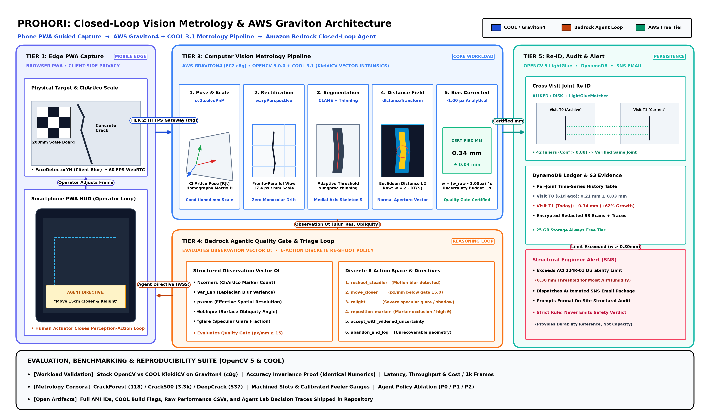

# PROHORI
## Agentic crack metrology on AWS Graviton
**AWS Compute Grant Proposal: OpenCV AI Competition 2026**

**Team:** Prohori · **Lead:** S M Hozaifa Hossain (solo) · **Declared path:** **both**: Cloud-Optimized Vision with COOL and Agentic Vision with OpenCV 5

---

## 1. Problem and intended real-world impact

On 24 April 2013, Rana Plaza collapsed outside Dhaka and killed 1,134 people. Cracks had been observed and reported the day before; workers were sent back inside.

The inspection regime built afterwards is active and funded, but still faces capacity limits. Reporting from the RMG Sustainability Council and International Accord records 93,576 hazards found in initial inspections of 1,755 factories, another 58,367 in follow-up inspections, and roughly 665 of some 1,800 factories fully remediated after more than a decade, with inspector availability cited as the primary bottleneck. Bangladesh's ready-made garment sector includes roughly 4,000 to 5,200 registered factories with 4.4 million workers, and generates about 80% of national export earnings.

Routine walkthroughs currently lack a cheap, repeatable numeric record: the same joint measured the same way over time by whoever walks the building.

PROHORI measures concrete crack width in millimetres from a standard smartphone camera, publishing an explicit error budget. When an image cannot support a reliable measurement, the system declines to output a number.

ACI 224R-01 Table 4.1 specifies tolerable crack widths by exposure condition (dry air 0.41 mm; humidity, moist air, or soil 0.30 mm; de-icing chemicals 0.18 mm; seawater 0.15 mm; water-retaining structures 0.10 mm). The standard caveats that these values "are not always a reliable indication of steel corrosion and deterioration of concrete to be expected." Because this table provides durability and appearance guidance under service load rather than a structural-capacity threshold, PROHORI never issues safety verdicts. It returns the measurement, its uncertainty bounds, the declared exposure class, the reference baseline, the change recorded since the prior inspection, and a prompt for a qualified engineer to evaluate the site. Declining to output numbers beyond what the optical physics can verify is a deliberate design rule.

## 2. Target users and beneficiaries

- Safety officers and independent structural engineers conducting walkthrough inspections who currently record qualitative crack notes when triage requires numeric data.
- Building owners and facility managers who need verifiable documentation between formal engineering audits.
- Low-resource settings like schools, clinics, and informal housing, where staff carry smartphones but lack optical crack comparators, total stations, or survey drones.

## 3. Planned OpenCV 5 image and video analysis

The core workload relies on a classical `imgproc` measurement pipeline. This pipeline uses the function family benchmarked in COOL's 78-function suite, testing compute efficiency directly on production code paths.

| OpenCV 5 component | Role |
|---|---|
| `aruco`: `CharucoDetector`, `solvePnP` | Recovers the crack plane pose and absolute metric scale from a printed ChArUco board. On a planar surface, this determines pose and scale directly and avoids the conditioning issues of monocular structure-from-motion. |
| `imgproc` / `core`: `warpPerspective`, `cvtColor`, CLAHE, `adaptiveThreshold`, `ximgproc.thinning`, `distanceTransform`, `findContours` | Executes the core measurement: rectifies images to a fronto-parallel view at a known pixel scale (px/mm), segments the crack, thins the skeleton, and computes local width from the distance transform. This workload runs under COOL on Graviton. |
| `features`: ALIKED, DISK, `LightGlueMatcher` | Handles cross-visit re-identification: matches the current frame against the stored reference image for a joint to confirm joint identity before calculating trends. Classical SIFT and ORB provide baseline comparisons. |
| `dnn`: ONNX segmentation | Evaluates whether a deep learning segmentation model reduces width error compared to classical adaptive thresholding. |
| `objdetect`: `FaceDetectorYN` | Redacts incidental human faces before saving images to disk. |
| HAL / Universal Intrinsics 2.0 / Arm KleidiCV | Provides vector acceleration for core image processing routines on Arm hardware. |

OpenCV 5.0.0 is installed on the local build machine. Each listed API has been validated through direct probes, including full ArUco board generation and detection round trips.

### Measurement work already completed

Before choosing an estimator, its systematic error was characterized against synthetic ground truth of exact pixel widths:

| True width (px) | 3 | 5 | 7 | 9 | 15 | 21 |
|---|---|---|---|---|---|---|
| `2 × distanceTransform` at skeleton | 4.00 | 6.00 | 8.00 | 10.00 | 16.00 | 22.00 |
| Error | +1.00 | +1.00 | +1.00 | +1.00 | +1.00 | +1.00 |
| area / length estimator | 3.04 | 5.11 | 7.21 | 9.35 | 16.00 | 23.01 |

The distance-transform estimator produces a constant +1.00 px bias across all evaluated widths. This offset comes from pixel-center coordinate conventions and is corrected analytically in closed form. Because the area/length estimator performs better below 9 px and the distance transform is more accurate above 9 px, the deployed pipeline selects the estimator according to observed crack width.

The uncertainty budget models scale calibration, plane pose, edge localization, blur residuals, and surface obliquity. Edge localization represents the primary error source on real concrete: at 15 px/mm, a 0.30 mm crack spans 4.5 px, where a ±1 px edge uncertainty on both sides introduces a ±0.13 mm margin. PROHORI enforces a minimum resolution threshold (px/mm) and withholds measurement certification if an image falls below this limit.

## 4. Agentic loop: vision-directed action

During field inspection, the system calculates an observation vector across six parameters: ChArUco corner count, Laplacian blur variance, effective spatial resolution (px/mm), surface obliquity angle, glare fraction, and crack pixel coverage. A triage agent on Amazon Bedrock evaluates these inputs, selects from six corrective actions (`reshoot_steadier`, `move_closer`, `relight`, `reposition_marker`, `accept_with_widened_uncertainty`, `abandon_and_log`), and displays concise instructions on the operator's camera view. Once image quality passes the certification gate, the system proceeds with joint re-identification, width measurement, trend analysis against historical records, and automated Amazon SNS escalation to the designated engineer. If capture criteria remain unmet after repeated attempts, the system logs the diagnostic failure code and records the measurement as unavailable.

In the offline development loop (Agent Lab), an automated agent analyzes performance differentials across categorized evaluation subsets (direct lighting vs. heavy shadows, hairline vs. wide apertures, painted vs. bare concrete) alongside latency and compute costs measured on Graviton. The agent drafts a targeted parameter hypothesis, applies the change, benchmarks the updated build, and proposes configuration updates. A human engineer must review and approve all production promotions. Generated hypotheses, benchmark logs, and deployment decisions are tracked in the repository.

To quantify agent utility, benchmark tasks run across three control policies: P0 (random action selection), P1 (deterministic threshold rules), and P2 (the LLM reasoning agent). Evaluation measures recovery success rate, average interaction turns required to reach certification, and escalation precision and recall. The protocol focuses on compound degradation states (such as simultaneous glare and surface obliquity under low blur) where individual thresholds fail to identify the proper corrective action. Policy definitions and evaluation criteria are registered prior to testing, and all comparative results across P0, P1, and P2 will appear in the final report.

## 5. AWS architecture

| Service | Role |
|---|---|
| **EC2 c8g + COOL 3.1 AMI (Graviton4)** | Executes the core computer vision pipeline and OpenCV 5 routines accelerated with COOL on Arm. |
| **EC2 t4g.small (Graviton2)** | Hosts the always-on orchestrator, TLS endpoint, and PWA application, providing the secure context required for browser camera access. |
| **AWS Lambda (arm64)** | Runs asynchronous background tasks and automated report generation. |
| **Amazon S3** | Stores reference images, model weights, and benchmark CSV datasets. |
| **Amazon DynamoDB** | Stores joint inspection histories, diagnostic failure codes, and agent execution logs. |
| **Amazon SNS** | Dispatches email alerts and escalation notices to nominated structural engineers. |
| **Amazon Bedrock** | Powers the triage agent and Agent Lab hypothesis generator, queried per decision event rather than per frame. |
| **Amazon CloudWatch** | Aggregates system metrics, centralized execution logs, and service traces. |

The infrastructure implements IAM least privilege, encryption at rest, private S3 buckets, and client-side face redaction prior to data persistence.

Grant credits will fund Graviton4 compute hours for the COOL benchmark campaign, Amazon Bedrock token usage for agent decisions, and the public demonstration endpoint throughout the judging period. Background infrastructure runs within AWS free tiers, focusing compute credits on active benchmarking and judge evaluations.

## 6. COOL plan

COOL accelerates the core image processing pipeline during live operations and interactive judge demonstrations.

The benchmark focuses exclusively on AWS Graviton4 with COOL 3.1, which is the verified environment built on OpenCV 5.0.0. Multi-generation comparisons across Graviton2, 3, and 4 were excluded because differing AMI packages distribute different OpenCV versions, which would confound hardware architecture variations with library differences.

Experimental baselines compare the COOL build against two reference environments: standard `pip opencv-python 5.0.0` and a source-built OpenCV 5.0.0 compiled with documented optimization and threading flags. Documenting compiler flags ensures recorded performance gains isolate the contribution of Arm KleidiCV vector extensions.

Reported metrics include latency per pipeline stage, total system throughput, compute cost per 1,000 processed frames, batch and thread scaling sweeps, and numerical accuracy verification. Crack width estimations must produce identical numerical outputs across both COOL and reference builds to confirm mathematical fidelity alongside compute acceleration. All raw benchmark logs, AMI identifiers, and configuration scripts will be included in the open-source repository.

## 7. Evaluation method

Segmentation accuracy is evaluated on established pixel-annotated datasets: CrackForest (118 images), Crack500 (approximately 3,368 annotated sub-images), and DeepCrack (537 images). SDNET2018 and METU/Özgenel provide image-level classification checks for dataset diversity, while pixel-level metrics rely strictly on masked datasets.

Ground-truth crack widths are established using precision-machined reference slots, calibrated feeler gauges, and optical crack-comparator cards on real concrete surfaces, with reference measurement tolerances explicitly documented. Because physical calipers cannot enter narrow 0.3 mm surface fissures, mechanical gauge measurements are avoided for true crack width validation.

Evaluation metrics track full width-error distributions with itemized uncertainty budgets, intersection over union (IoU) across segmentation benchmarks, agent recovery rates, interaction turn counts to reach certification, escalation precision and recall, and the complete COOL performance suite.

Ablation experiments evaluate classical vs. deep learning segmentation, hand-crafted feature extractors (SIFT, ORB) vs. learned keypoint matching (ALIKED, DISK, LightGlue), single-frame capture vs. the guided reshoot loop, policy effectiveness across P0, P1, and P2, and COOL acceleration vs. unaccelerated OpenCV.

The evaluation directly tests six operational failure modes: motion blur, poor illumination, ChArUco marker occlusion or specular glare (which restricts output to relative pixel dimensions without extrapolating absolute scale), resolution below the certification threshold, hairline cracks approaching the 0.06 mm detection floor, and environmental domain shifts across painted, plastered, and monsoon-weathered masonry.

Because physical concrete fractures rarely exhibit measurable structural expansion within a 59-day observation period, multi-visit trending will be validated on a precision-adjusted physical test fixture. The demonstration video clearly identifies this setup on screen to maintain complete experimental transparency.

## 8. Judge demonstration

Evaluators can access the public HTTPS application from a smartphone browser and target a printed test panel containing a calibrated reference slot alongside a ChArUco board. If the initial frame is intentionally blurred or misaligned, the triage agent displays the underlying diagnostic rationale and prompts for a specific adjustment. Once corrected, the interface returns the calculated crack width, associated uncertainty bounds, and verified spatial resolution (px/mm). Evaluators can subsequently inspect the inspection history timeline and review Agent Lab optimization logs showing approved deployment updates. A live screen-share demonstration is also available upon request.

The five-minute presentation video details the project scope, system architecture, real-time capture workflows, the metrology error budget, policy ablation results (P0, P1, and P2), and COOL performance benchmarks displaying active AMI identifiers. The video concludes with recorded edge cases, including marker glare reflections, resolution refusals, and domain-shift evaluations.

## 9. Team

S M Hozaifa Hossain (sole member) is a graduating Electrical and Electronic Engineering undergraduate at the University of Dhaka, Bangladesh (CGPA 3.73 / 4.00), with a research background in physical device modeling, computer vision, and applied machine learning.

Honors include winning the IEEE EDS TCAD Hackathon 2026 (organized by the IEEE Electron Devices Society Educational Activities Committee) for modeling and optimizing sub-10nm stress-engineered Gate-All-Around nanowires on consumer hardware. Recipient of the IEEE Humanitarian Technologies Board (HTB) Certificate of Recognition (2025) for leading Project 23-HTB-115, deploying energy-efficient computing systems in rural schools. IELTS Academic: 8.0 Overall (Listening: 9.0, Reading: 8.0, Writing: 7.0, Speaking: 7.0).

Peer-reviewed publications:
- Computer vision and video machine learning: Samiul Islam*, S M Hozaifa Hossain*, et al., *International Journal of Activity and Behavior Computing* (IJABC, 2024). YOLOv7 pose estimation and XGBoost classification pipeline for procedural activity recognition (97.0% F1-score).
- Deep learning and inverse physics: Mohammad Ajmain Fatin*, Arpan Saha*, S M Hozaifa Hossain, et al., *IEEE International Electron Devices and Technology Meeting* (EDTM, 2026). Deep-learning inverse design using multi-branch tandem neural networks over 6,000 FDTD physics simulations.
- Language models and reasoning: Hasin Jawad Ali, Ajwad Abrar, S M Hozaifa Hossain, et al., *Social Network Analysis and Mining* (Springer Nature, 2026). Stance classification via Scoring and Reflective Re-read prompting with Mixtral 8x7B (74.08% accuracy).

Measurement and systems experience includes an undergraduate thesis on Gate-All-Around Ferroelectric FETs (GAA-FeFETs) and Spiking Neural Networks advised by Dr. Mainul Hossain (former Principal Engineer at GlobalFoundries), implementing PyTorch SNNs with SpikingJelly LIF neurons for MIT-BIH ECG classification. In device physics, rigorous measurement bounds are foundational; this same metrological discipline guides PROHORI's error budget and closed-form bias compensation. On applied systems, built *Torbiz* (distributed edge LLM inference across consumer hardware using FastAPI, Rust, and Docker), *Muhasaba* (offline-first PWA with an 18-tool Model Context Protocol agent server), and worked as PMO Lead for KPMG Bangladesh (RRH) digital product modernization.

The implementation plan focuses on milestones achievable by a single developer within the competition timeline. Planar ChArUco pose estimation provides a robust alternative to complex multi-view reconstruction, benchmark suites target a single verified Graviton4 COOL 3.1 AMI, and optimization promotions require human confirmation. The initial development phase establishes an end-to-end pipeline delivering metric crack measurements from mobile camera inputs to a live HTTPS endpoint.
